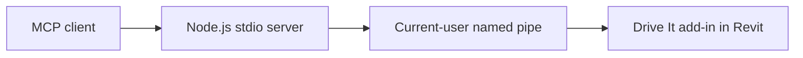

# Drive It

**Connect Model Context Protocol clients to Autodesk Revit on the same Windows workstation.**

[](https://github.com/jedbjorn/drive-it/actions/workflows/build.yml)
[](https://github.com/jedbjorn/drive-it/releases/latest)
[](https://github.com/jedbjorn/drive-it/blob/main/LICENSE)

[](#requirements)
[](#build-and-install)
[](#build-and-install)
[](#requirements)
[](https://md-converter.designs-os.com/?url=https://github.com/jedbjorn/drive-it/blob/main/README.md)
[](https://glama.ai/mcp/servers/jedbjorn/drive-it)

**Topics:** `revit` · `revit-addin` · `bim` · `mcp` · `model-context-protocol` · `dotnet` · `nodejs` · `autodesk`

**[Project website →](https://drive-it.designs-os.com/)**

## Overview

Drive It connects a Model Context Protocol (MCP) client to Autodesk Revit 2026 through a small Node.js server and a native Revit add-in. The Unguided alpha exposes these stdio MCP tools:

- `get_revit_session` finds the running Revit (when only one has Drive It loaded, no process ID is needed) and returns its version, build, named-pipe identity, the workspace root, and Revit's installed project templates, family template folders, and library folders, so the agent uses real paths instead of guessing.
- `execute_script` runs inline Python, or a saved script revision from the workspace library, in an isolated fixed Python worker. Every call carries a required `displayName`: one plain-language line the agent writes for you, such as "Add Level 3 at 24 ft to the tower model". It is kept on the run receipt and on any outside-root request, and the operator surface lists runs and requests by it.
- `save_script`, `search_scripts`, `get_script`, `promote_script`, and `retire_script` manage the workspace script library (see [Script library](#script-library)).
- `get_api_reference` returns local, versioned references for the callable Drive It file, check, and Revit operations. `get_guidance` is not registered.

Generated Python receives `args`, `files`, `revit`, and `checks`. It does not receive raw Revit objects. Typed model operations use the Drive It add-in's current-user named pipe and execute in Revit's API context. The worker uses Python isolated mode, blocks package installation, process execution, native loading, and thread creation, and records observed effects and checks in a durable run receipt. Scripts can import only the modules in `ALLOWED_MODULES` in `server/worker.py` (in-memory data, text, math, and date utilities plus `os`/`pathlib` for mediated file access); every other import or module load is denied. This is a guardrail for generated code, not an operating-system sandbox.

Drive It is in early development. The Windows alpha MSI is the recommended way to install it; the script installer, source build, and release bundle below remain available.

## How it works

The MCP client launches Drive It's Node.js server over stdio. The server connects to a named pipe created by the Drive It add-in inside the selected Revit process. Each Revit instance has its own pipe, restricted to the current Windows user.



## Workspace and outside-root decisions

Select the persistent workspace in the Drive-It window (Start Menu, or **Add-Ins › Drive-It** in Revit). During development, the equivalent direct commands are:

```powershell
node server/operator.js workspace set C:\DriveIt
node server/operator.js workspace get
```

Reads, creates, overwrites, renames, moves, and deletes inside the canonical root do not produce a Drive It prompt. Reading Revit's own installed content also needs no prompt: reading files and folders, opening documents, and using a file as a template under `%ProgramData%\Autodesk\RVT 2026\Templates`, `Family Templates`, and `Libraries`. Writing there still needs a decision. Links and junctions are resolved at the point of use. An outside-root request returns a `pending` receipt and changes nothing in the requested batch. List the request and make a one-time decision:

```powershell
node server/operator.js decisions list
node server/operator.js decisions approve <decision-id>
node server/operator.js decisions deny <decision-id>
```

After approval, retry the same execution with the same idempotency key. The grant is consumed by that execution and is not reused. Denial returns a `denied` receipt. Changing the workspace affects future operations; existing receipts retain their originating root.

Run history remains local to the Windows user and is available after a root change:

```powershell
node server/operator.js history list
node server/operator.js history get <run-id>
```

Completed idempotent requests return their original receipt without repeating effects. Receipts distinguish pending, denied, failed, timed-out, partially applied, and succeeded runs.

## Script library

Each workspace root has its own script library in `<root>\.drive-it\scripts`. Changing the root selects that root's library and leaves the other in place. Library operations need no Drive It approval.

- `save_script` stores a new **draft** script, or a new immutable integer revision of an existing one, with its source, code hash, purpose, domain, document kind (`rvt` or `rfa`), JSON Schema for its arguments, expected effects, and provenance. Saves never edit an existing revision. Retrying the same `idempotencyKey` returns the revision already saved.
- `execute_script` runs `{"scriptId": "...", "revision": 2}` for an exact draft or active revision, or `"revision": "latest"` for the newest **active** revision. Arguments are validated against the revision's schema and its defaults are applied. Retired revisions are rejected.
- `promote_script` makes a draft **active** when the supplied run is a checked successful run of that exact revision in the same workspace: status `succeeded`, at least one check, every check passed, the same code hash, and the declared document kind. No human approval is involved. A rejection names each unmet condition and leaves the draft unchanged.
- `retire_script` soft-retires a draft or active revision. Its source, metadata, and receipts are kept and remain visible through `get_script`, but it leaves default search and `latest` and cannot run.
- `search_scripts` returns active revisions by default; pass `includeDrafts` or `includeRetired` to see more. `get_script` returns one revision with its source and its linked run receipts.

A missing or unreadable library is reported as an error (`LIBRARY_NOT_FOUND`, `LIBRARY_UNREADABLE`), not an empty catalog. The first `save_script` creates the library.

## Requirements

The Windows alpha installer requires Windows and Autodesk Revit 2026. It provisions private Node.js and Python runtimes and reuses a suitable existing .NET runtime or provisions .NET 8 in Drive It's private runtime directory. No administrator account, development checkout, global Node.js/npm, or global Python is required.

For a source build, install:

- Windows
- Autodesk Revit 2026
- .NET 8 SDK
- Node.js 22 or newer
- Python 3 for source builds

Revit is required to use the add-in, but not to run the Node.js tests or compile the project. Revit API references resolve from NuGet.

## Build and install

### Windows alpha (MSI)

1. Download `DriveIt-<version>-x64.msi` from the [latest release](https://github.com/jedbjorn/drive-it/releases) and run it. It is a per-user install and needs no administrator account. The alpha MSI is unsigned, so Windows SmartScreen may warn you first: choose **More info**, then **Run anyway**.
2. Start Revit 2026. Revit asks about the unsigned Drive It add-in the first time; choose **Always Load**.
3. Open **Drive-It** from the Start Menu, or click **Drive-It** on Revit's **Add-Ins** tab, and select your workspace folder.
4. Restart Claude or Codex so it picks up the new `drive-it` MCP server.

The MSI registers Drive It with every supported MCP client it finds for your Windows user, and leaves everything else in their configuration unchanged:

| Client | Detected by | Configuration written |
|---|---|---|
| Claude Desktop | `%APPDATA%\Claude` exists | `mcpServers.drive-it` in `%APPDATA%\Claude\claude_desktop_config.json` |
| Claude Desktop (Microsoft Store) | `%LOCALAPPDATA%\Claude-Data\claude_<id>` exists | `mcpServers.drive-it` in `claude_desktop_config.json` in that folder |
| Claude Code | `%USERPROFILE%\.claude.json` exists | user-scope `mcpServers.drive-it` in `%USERPROFILE%\.claude.json` |
| Codex (CLI and app) | `%USERPROFILE%\.codex` exists | a marked `[mcp_servers.drive-it]` block in `%USERPROFILE%\.codex\config.toml`, with a 150-second tool timeout |

Before changing a client file, the installer saves a copy next to it as `<file>.drive-it.bak`. If a client configuration cannot be read, or Codex already has its own `[mcp_servers.drive-it]` table, that client is skipped and its file is left untouched. If you install a client after Drive It, repair Drive It from the folder that holds the MSI with `msiexec /fa DriveIt-<version>-x64.msi` to register it. You can also copy the entry from `%LOCALAPPDATA%\DriveIt\mcp.json` into any other stdio MCP client.

To remove Drive It, uninstall it from Settings > Apps. This removes the application, the Revit add-in registration, the Start Menu shortcut, and the `drive-it` entries it added to Claude and Codex. Your workspace selection and run receipts in `%LOCALAPPDATA%\DriveIt` are kept. For an unattended install or removal, use `msiexec /i DriveIt-<version>-x64.msi /qn` or `msiexec /x DriveIt-<version>-x64.msi /qn`.

### Windows alpha (script installer)

The script installer is still available: extract `drive-it-windows-alpha.zip` from a CI build and run `Install-DriveIt.ps1` in PowerShell.

```powershell
.\Install-DriveIt.ps1 -WorkspaceRoot "C:\DriveIt"
```

Both installers place the application, private Node.js/Python runtimes, and local data in `%LOCALAPPDATA%\DriveIt`, write a ready-to-use stdio configuration to `%LOCALAPPDATA%\DriveIt\mcp.json`, and register the detected clients above. The MCP environment points `DRIVE_IT_DATA_DIR` at that data directory and `DRIVE_IT_PYTHON` at the bundled Python executable. The installer verifies the runtimes and starts the installed MCP server before registering the current-user Revit 2026 add-in. Existing toolchains are not replaced.

With the script installer, pass `-McpConfigPath <path>` to merge the same entry into another MCP client configuration while preserving its other servers. Re-running the installer preserves the selected root and existing client settings. Use `-NoLaunch` for unattended installation.

The Drive-It window opens from the Start Menu (`Drive-It`) and from the **Drive-It** panel on Revit's **Add-Ins** tab; inside Revit it follows Revit's light or dark theme, and from the Start Menu the Windows app theme. Use it for first-run root selection. The same window changes the root, shows each pending outside-root operation and resolved path, records a one-time approval or denial, and displays retained run receipts. Approval does not change the root or authorize later requests.

The window (`app\operator\DriveIt.Operator.exe` and `DriveIt.UI.dll` in the add-in folder) uses the installed private Node runtime to call `server/operator.js` directly: `workspace get|set`, `decisions list|approve|deny`, and `history list`. Runs and pending requests are listed by their display name when they carry one, with the run ID in the details. These commands are not MCP tools. The shared local state contract is:

- `workspace.json`: the selected root used for future operations.
- `decisions/<id>.json`: pending, approved, denied, or consumed requests with canonical `operation` and `paths` details. Approval is consumed once and never reused for another request.
- `runs/<run-id>.json`: retained receipts, each with the run's `displayName`, displayed independently of the current root.

### Source build

From a source checkout, run these commands in PowerShell with Revit closed:

```powershell
npm ci
dotnet build src/DriveIt.Revit -c Release

$build = "src/DriveIt.Revit/bin/Release/net8.0-windows"
$addins = Join-Path $env:APPDATA "Autodesk/Revit/Addins/2026"
New-Item -ItemType Directory -Force "$addins/DriveIt" | Out-Null
Copy-Item "$build/DriveIt.Revit.dll", "$build/DriveIt.UI.dll", "$build/DriveIt.Core.dll" "$addins/DriveIt/"
Copy-Item "$build/DriveIt.addin" "$addins/"
```

Tagged releases also provide the compiled add-in and MCP server as `DriveIt-<version>.zip`, with checksums for every asset in `SHA256SUMS.txt`. Extract the bundle, run `npm ci` in its directory, then copy `DriveIt.addin` and the `DriveIt` folder into `%APPDATA%\Autodesk\Revit\Addins\2026` as above.

Start Revit and allow the add-in to load. Configure your MCP client to launch the server over stdio, replacing the example path with your checkout or extracted release bundle:

```json
{
  "mcpServers": {
    "drive-it": {
      "command": "node",
      "args": ["C:\\Repos\\drive-it\\server\\index.js"]
    }
  }
}
```

The installed alpha supplies its own Node and fixed Python runtime. `DRIVE_IT_PYTHON` selects the Python executable during development or installed setup. Runtime state defaults to `%LOCALAPPDATA%\DriveIt`; `DRIVE_IT_DATA_DIR` overrides it for isolated development tests.

## Use

`get_revit_session` and `execute_script` find the running Revit on their own when only one Revit has the Drive It add-in loaded. With several Revit windows open, the agent is told which process IDs are running and asks which to use; it then passes that `processId`. When a run needs an outside-root approval, the tool tells the agent to ask you to decide in the Drive-It window and to resume with the same `idempotencyKey`.

A successful session response contains the selected Revit process and its version information:

```json
{
  "processId": 12345,
  "version": "2026",
  "build": "26.4.10.51"
}
```

If the connection fails, check that the process ID belongs to Revit and that the Drive It add-in loaded successfully.

## Revit broker

The current-user named pipe `\\.\pipe\drive-it-<pid>` retains its session greeting. After reading the greeting, an execution client sends one newline-delimited JSON request and reads one JSON response on that connection:

```json
{
  "id": "<run uuid>",
  "type": "model.execute",
  "document": { "path": "<canonical path or null>", "uniqueId": "<broker-issued identity or null>" },
  "workspaceRoot": "<canonical root>",
  "operations": [{ "type": "read_document", "arguments": {} }]
}
```

Document operations are `open_document`, `create_document`, `read_document`, `save_document`, `save_as_document`, `close_document`, and `delete_document`. Typed model changes are `create_level`, `create_wall`, `create_family_type`, and `delete_element`. Consecutive model changes run in one Revit transaction through `ExternalEvent`. The response's `document.uniqueId` remains bound to the same Revit document across save-as.

Responses have `succeeded`, `failed`, `partially_applied`, or `policy_required` status and list observed `changes`, `affectedFiles`, `affectedElements`, and `checks`. Before any mutation, the broker canonicalizes the complete batch, including links and junctions. An uncovered outside-root read or effect returns `policy_required` with `policyRequests`. Node can retry with an operator decision:

```json
{
  "outsideRootApproval": {
    "decisionId": "<node-generated decision>",
    "grants": [{ "operation": "save_as_document", "paths": ["<resolved path>"] }]
  }
}
```

Only the Node broker client may attach this payload; generated Python cannot approve its own request. Grants cover only the matching operation and canonical paths in that execution and are not persisted.

## Development

Build the self-contained installer package on a development machine with `installer/Build-DriveItPackage.ps1`. The builder runs npm and dotnet only while packaging, downloads the fixed official Node.js/Python runtimes, bundles production dependencies, and creates `artifacts/DriveIt-alpha.zip`. Then `installer/Build-DriveItMsi.ps1` (PowerShell 7.3+) wraps that package in `artifacts/DriveIt-alpha.msi` with WiX Toolset v5, which it installs as a .NET global tool if it is missing.

- `server/app.js` registers the MCP tools and their schemas.
- `server/runtime.js` owns execution, broker policy retries, receipts, and idempotent replay.
- `server/worker.py` mediates Python file and typed Revit operations and blocks package/process installation paths.
- `server/workspace.js`, `server/decisions.js`, and `server/history.js` persist policy and run evidence outside the selected workspace.
- `src/DriveIt.Revit/App.cs` serves the session greeting and typed requests, and adds the **Drive-It** panel (button `DriveIt.OpenOperator`) to the Add-Ins tab. `Broker/RevitBroker.cs` raises an external event, and `Broker/DocumentDispatcher.cs` executes document and model operations in Revit's API context.
- `npm test` exercises real stdio discovery, isolated Python execution, policy and failure paths, replay, operator commands, and temporary-file cleanup. Windows runs also exercise the named-pipe session, newline-JSON broker contract, operator state, approvals, and run history.
- `dotnet build src/DriveIt.Revit -c Release` compiles the Revit 2026 add-in. The operator window is `src/DriveIt.UI` (WPF, the family theme copied from Splash-It), hosted in Revit and by `src/DriveIt.Operator` (the Start Menu exe); its operator.js client and labels are in `src/DriveIt.Core`, tested by `dotnet test test/DriveIt.Core.Tests` on any OS.
- `DriveIt.Operator.exe --self-test <report.json>` opens and closes the window in both themes against the installed operator.js; the installer and MSI tests run it.
- CI builds the Windows alpha package and MSI, runs the script installer tests, then installs and uninstalls the MSI silently and checks the add-in, Claude/Codex registrations, and preserved user data.
- `test/clients.test.js` covers the Claude Desktop, Claude Code, and Codex configuration merges and their removal.
- `test/revit-broker.integration.ps1` exercises the live broker against a running Revit process. Copy a project template to `C:\DriveIt\broker-fixtures\broker-project.rte` and a family template to `broker-family.rft`, then run `powershell -ExecutionPolicy Bypass -File test/revit-broker.integration.ps1 -ProcessId <pid>`. It writes JSONL receipts to that workspace and uses only disposable model files.

GitHub Actions runs the tests and build on `windows-latest` for pull requests and pushes to `main`. It uses only GitHub-hosted runners; no local runner or Revit installation is required. Live Revit verification is a separate manual check.

Live RVT/RFA behavior still requires the installed-alpha Revit fixtures and acceptance environment; local mocks and pipe tests do not establish live model proof.

To release, push a `v<major>.<minor>.<patch>` tag for a commit on `main`, optionally with a prerelease suffix such as `-rc.1`. The release workflow runs the same build, attaches `DriveIt-<version>-x64.msi` and the add-in/server bundle with SHA-256 checksums, and creates a GitHub Release (marked as a prerelease when the tag has a suffix). The MSI product version drops the prerelease suffix, because Windows Installer versions are numeric.

## Contributing

Issues and focused pull requests are welcome. Include the Revit and Windows versions for add-in reports, and do not attach private models, credentials, or other sensitive data. Before submitting a change, run `npm test` and `dotnet build src/DriveIt.Revit -c Release` where your environment supports them.

## More projects

Other open-source projects by the same author, published as [Designs/OS](https://designs-os.com):

- **[RST-C](https://rst-c.designs-os.com/)** — curated Revit ribbon profiles in one native add-in. ([source](https://github.com/jedbjorn/rst-c))
- **[Gantt-It](https://gantt-it.designs-os.com/)** — Gantt charts inside Revit, ready to place on sheets. ([source](https://github.com/jedbjorn/gantt-it))
- **[Splash-It](https://splash-it.designs-os.com/)** — colors Revit view tabs by file. ([source](https://github.com/jedbjorn/splash-it))
- **[Pick-It](https://pick-it.designs-os.com/)** — picks a color and shows its RGB values on the Revit ribbon. ([source](https://github.com/jedbjorn/pick-it))
- **[FAI Browser](https://fai-browser.designs-os.com/)** — a safer browser for coding agents. ([source](https://github.com/jedbjorn/fai-browser))
- **[Subfloor](https://subfloor.designs-os.com)** — persistent coding-agent teams with durable identity, memory, specs, and handoffs. ([source](https://github.com/jedbjorn/subfloor))

## License

[MIT](LICENSE) · Copyright © 2026 Designs/OS
