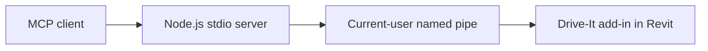

# Drive-It

**Connect Model Context Protocol clients to Autodesk Revit on the same Windows workstation.**

**Topics:** `revit` · `revit-addin` · `bim` · `mcp` · `model-context-protocol` · `dotnet` · `nodejs` · `autodesk`

**[Project website →](https://drive-it.designs-os.com/)**

Drive-It connects a Model Context Protocol (MCP) client to Autodesk Revit 2026 or Revit 2027 through a small Node.js server and a native Revit add-in. Drive-It is in early development. The Windows alpha MSI is the recommended way to install it; the script installer, source build, and release bundle remain available.

## Capabilities

- **Revit 2026 and 2027, side by side.** One install registers the add-in for both years. The agent finds the running Revit itself, or asks which one to use when several are open ([Use](https://github.com/jedbjorn/drive-it/blob/main/docs/how-it-works.md#use)).
- **Python scripts against the model.** `execute_script` runs the Python an agent writes in an isolated worker outside Revit, so a script that crashes or hangs does not take Revit down ([Python environment](https://github.com/jedbjorn/drive-it/blob/main/docs/scripting.md#python-environment)).
- **Built-in primitives and operations.** Find elements; read and set instance, type and family parameters; read and set the selection; list types and views; edit families; open, create, save, close and delete documents; and create levels, walls, 3D views and family types. Each one checks its input before it changes anything ([Built-in primitives](https://github.com/jedbjorn/drive-it/blob/main/docs/scripting.md#built-in-primitives)).
- **The Revit API through a bridge.** Anything the primitives do not cover, such as placing families, sheets, schedules or family geometry, can call Revit's modeling API directly. Drive-It owns the transactions, rolls a failed run back, and makes a successful run one undo entry ([Revit API bridge](https://github.com/jedbjorn/drive-it/blob/main/docs/api-bridge.md)).
- **Document targets.** A task changes only the documents it names, so switching windows in Revit while the agent works does not move the task to another model ([How it works](https://github.com/jedbjorn/drive-it/blob/main/docs/how-it-works.md#document-targets)).
- **Dry run.** The agent can rehearse a script: Revit applies the changes, Drive-It records what would be created, modified and deleted (each value before and after) along with images of the affected views, and then everything is rolled back. On a workshared model it also releases the elements the rehearsal borrowed ([Dry run](https://github.com/jedbjorn/drive-it/blob/main/docs/dry-run.md)).
- **Require dry run and Staged Actions.** An optional setting makes the agent rehearse every change before it runs for real and stops the agent from saving. While it is on, the Drive-It window shows the latest dry run for you to review ([Require dry run](https://github.com/jedbjorn/drive-it/blob/main/docs/dry-run.md#require-dry-run)).
- **View capture with element marks.** The agent exports a Revit view to a PNG to check its own work, optionally with numbered marks identifying elements ([View capture](https://github.com/jedbjorn/drive-it/blob/main/docs/view-capture.md)).
- **Script library.** Each workspace keeps a library of saved scripts with immutable revisions. A draft becomes active only after a checked, successful run ([Script library](https://github.com/jedbjorn/drive-it/blob/main/docs/script-library.md)).
- **Receipts and run history.** Every run leaves a durable receipt: its changes, affected elements and files, checks, and outcome. A retried request returns its original receipt instead of repeating the work ([Workspace and outside-root decisions](https://github.com/jedbjorn/drive-it/blob/main/docs/how-it-works.md#workspace-and-outside-root-decisions)).
- **A workspace boundary.** Work inside the workspace folder needs no prompt. A write outside it waits for your one-time approval in the Drive-It window ([Workspace and outside-root decisions](https://github.com/jedbjorn/drive-it/blob/main/docs/how-it-works.md#workspace-and-outside-root-decisions)).
- **The Drive-It window.** You can open it from the Start Menu or from Revit's Add-Ins tab. Use it to pick the workspace, approve or deny requests, browse run history, and review staged dry runs. Its settings cover the script time limit, Require dry run, and **Detect agents** ([The Drive-It window](https://github.com/jedbjorn/drive-it/blob/main/docs/install.md#the-drive-it-window)).
- **A one-step install.** A signed, per-user MSI that needs no administrator account brings its own Node.js and Python runtimes and registers Drive-It with Claude Desktop, Claude Code, Codex CLI and the ChatGPT desktop app ([Install](https://github.com/jedbjorn/drive-it/blob/main/docs/install.md)).
- **Dev Mode.** An administrator-installed mode with every guardrail off, for driving Revit on a disposable VM over SSH ([Dev Mode](https://github.com/jedbjorn/drive-it/blob/main/docs/dev-mode.md)).

## MCP tools

The Unguided alpha exposes these stdio MCP tools:

- `get_revit_session` finds the running Revit (when only one has Drive-It loaded, no process ID is needed) and returns its version, build, named-pipe identity, the workspace root, Revit's installed project templates, family template folders, and library folders, so the agent uses real paths instead of guessing, and the open documents (`openDocuments`), with the one in Revit's window marked.
- `execute_script` runs inline Python, or a saved script revision from the workspace library, in an isolated fixed Python worker. Every call carries a required `displayName`: one plain-language line the agent writes for you, such as "Add Level 3 at 24 ft to the tower model". It is kept on the run receipt and on any outside-root request, and the operator surface lists runs and requests by it. `targets` names the open documents the run may change (see [How it works](https://github.com/jedbjorn/drive-it/blob/main/docs/how-it-works.md#document-targets)), and `dryRun` rehearses the script and rolls it back (see [Dry run](https://github.com/jedbjorn/drive-it/blob/main/docs/dry-run.md)).
- `save_script`, `search_scripts`, `get_script`, `promote_script`, and `retire_script` manage the workspace script library (see [Script library](https://github.com/jedbjorn/drive-it/blob/main/docs/script-library.md)).
- `capture_revit_view` exports an existing Revit view to a PNG and returns the image so the agent can check its own work (see [View capture](https://github.com/jedbjorn/drive-it/blob/main/docs/view-capture.md)).
- `get_api_reference` returns local, versioned references for the callable Drive-It file, check, and Revit operations. The version names the selected Revit session's version (for example `revit-2027-alpha.4`); with no session selected it names both supported versions, whose built-in operations are the same. `get_guidance` is not registered.

## How it works

The MCP client launches Drive-It's Node.js server over stdio. The server connects to a named pipe created by the Drive-It add-in inside the selected Revit process. Each Revit instance has its own pipe, restricted to the current Windows user.

Which documents a run may change is covered under [document targets](https://github.com/jedbjorn/drive-it/blob/main/docs/how-it-works.md#document-targets).

## Safety and ability

What the bridge lets a script do, and what it costs:

1. Scripts run in Drive-It's own process. A script that crashes or hangs does not crash Revit.
2. Through the bridge a script can call Revit's modeling API in general. Drive-It does not check a bridge call before it runs; built-in primitives do check first, and are preferred where they fit.
3. Revit is paused while a bridge run is in progress, up to the run's time limit. A window says so and offers Stop.
4. If a bridge run fails, is stopped or times out, its changes are rolled back. Changes before a save in the same run are kept.
5. A successful run is one undo entry in Revit.
6. File and system access is limited by rules that are a guardrail, not a guarantee. Run scripts from sources you trust.
7. Bridge scripts are written against one Revit version's API and may need changes for another.
8. A long task runs as many scripts. The time limit applies to each one, Revit is free between them, and each is its own undo entry. The limit is set in the Drive-It window.

In the Drive-It window, the time limit is under **Settings**.

`get_api_reference` returns the same statements as `safety`, and the server's instructions carry them for the agent.

## Requirements

- Windows
- Autodesk Revit 2026, Revit 2027, or both
- The installer brings its own Node.js and Python runtimes and needs no administrator account.

The [install guide](https://github.com/jedbjorn/drive-it/blob/main/docs/install.md#requirements) has the .NET runtime details, the add-in manifest table and the source-build prerequisites.

## Model recommendation

- Drive-It is tested with Claude Opus 5.5 on High thinking.
- A GPT Sol or Opus class model, or better, is recommended.
- Drive-It does not enforce this.

## Install

### Windows (MSI)

1. Download `DriveIt-<version>.msi` from the [latest release](https://github.com/jedbjorn/drive-it/releases/latest) and run it. It is a per-user install and needs no administrator account, and it needs Autodesk Revit 2026 or 2027 on the computer. It installs the add-in for both years, so a Revit year you install later finds Drive-It already in place. Releases are digitally signed by **AnJ Arch-Tech LLC**, the company behind Designs/OS. To check, right-click the MSI and choose **Properties › Digital Signatures**.
2. Start Revit 2026 or 2027. Each Revit asks about the Drive-It add-in the first time; choose **Always Load**.
3. Open **Drive-It** from the Start Menu, or click **Drive-It** in the **Drive-It** panel on Revit's **Add-Ins** tab. Your workspace starts as `C:\DriveIt\default`; choose another folder there if you want one.
4. Restart Claude, ChatGPT or Codex so it picks up the new `drive-it` MCP server. In the ChatGPT desktop app, Drive-It's tools are available in Codex and Work mode, not in plain Chat.
5. The first time the assistant calls a Drive-It tool, the client asks for permission. Choose **Always allow** so later runs are not interrupted; Drive-It still asks you itself before a script writes outside your workspace.

The [install guide](https://github.com/jedbjorn/drive-it/blob/main/docs/install.md) covers client registration, unattended install, uninstall, the script installer and source builds.

## Documentation

| Document | What it covers |
|---|---|
| [How it works](https://github.com/jedbjorn/drive-it/blob/main/docs/how-it-works.md) | Document targets, workspace and outside-root decisions, run history, session selection |
| [Scripting](https://github.com/jedbjorn/drive-it/blob/main/docs/scripting.md) | The Python environment and the built-in primitives |
| [Revit API bridge](https://github.com/jedbjorn/drive-it/blob/main/docs/api-bridge.md) | Calling Revit's modeling API from a script, and its guardrails |
| [Dry run](https://github.com/jedbjorn/drive-it/blob/main/docs/dry-run.md) | Rehearsing a script, workshared models, Require dry run and Staged Actions |
| [View capture](https://github.com/jedbjorn/drive-it/blob/main/docs/view-capture.md) | Exporting views to PNG, element marks and reference images |
| [Script library](https://github.com/jedbjorn/drive-it/blob/main/docs/script-library.md) | Saving, promoting and retiring scripts |
| [Install](https://github.com/jedbjorn/drive-it/blob/main/docs/install.md) | Requirements, client registration, unattended install, script installer, Drive-It window, source build |
| [Dev Mode](https://github.com/jedbjorn/drive-it/blob/main/docs/dev-mode.md) | Every guardrail off, for disposable test VMs |
| [Revit broker](https://github.com/jedbjorn/drive-it/blob/main/docs/broker-protocol.md) | The named-pipe protocol between the server and the add-in |
| [Development](https://github.com/jedbjorn/drive-it/blob/main/docs/development.md) | Build, tests, CI and releases |

## Contributing

Issues and focused pull requests are welcome. Include the Revit and Windows versions for add-in reports, and do not attach private models, credentials, or other sensitive data. Before submitting a change, run `npm test`, `dotnet test test/DriveIt.Core.Tests`, and `dotnet build src/DriveIt.Revit -c Release` where your environment supports them.

## More projects

Other open-source projects by the same author, published as [Designs/OS](https://designs-os.com):

- **[RST-C](https://rst-c.designs-os.com/)** — curated Revit ribbon profiles in one native add-in. ([source](https://github.com/jedbjorn/rst-c))
- **[Gantt-It](https://gantt-it.designs-os.com/)** — Gantt charts inside Revit, ready to place on sheets. ([source](https://github.com/jedbjorn/gantt-it))
- **[Splash-It](https://splash-it.designs-os.com/)** — colors Revit view tabs by file. ([source](https://github.com/jedbjorn/splash-it))
- **[Pick-It](https://pick-it.designs-os.com/)** — picks a color and shows its RGB values on the Revit ribbon. ([source](https://github.com/jedbjorn/pick-it))
- **[FAI Browser](https://fai-browser.designs-os.com/)** — a safer browser for coding agents. ([source](https://github.com/jedbjorn/fai-browser))
- **[Subfloor](https://subfloor.designs-os.com)** — persistent coding-agent teams with durable identity, memory, specs, and handoffs. ([source](https://github.com/jedbjorn/subfloor))

## License

[MIT](LICENSE) · Copyright © 2026 Designs/OS
