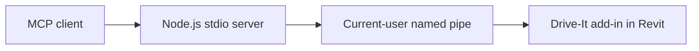

# Drive-It

**Connect Model Context Protocol clients to Autodesk Revit on the same Windows workstation.**

[](https://github.com/jedbjorn/drive-it/actions/workflows/build.yml)
[](https://github.com/jedbjorn/drive-it/releases/latest)
[](https://github.com/jedbjorn/drive-it/releases)
[](https://github.com/jedbjorn/drive-it/blob/main/LICENSE)

[](#requirements)
[](#requirements)
[](#install)
[](#install)
[](#requirements)
[](https://md-converter.designs-os.com/?url=https://github.com/jedbjorn/drive-it/blob/main/README.md)
[](https://glama.ai/mcp/servers/jedbjorn/drive-it)

**Topics:** `revit` · `revit-addin` · `bim` · `mcp` · `model-context-protocol` · `dotnet` · `nodejs` · `autodesk`

**[Project website →](https://drive-it.designs-os.com/)**

## Overview

Drive-It connects a Model Context Protocol (MCP) client to Autodesk Revit 2026 or Revit 2027 through a small Node.js server and a native Revit add-in. The Unguided alpha exposes these stdio MCP tools:

- `get_revit_session` finds the running Revit (when only one has Drive-It loaded, no process ID is needed) and returns its version, build, named-pipe identity, the workspace root, and Revit's installed project templates, family template folders, and library folders, so the agent uses real paths instead of guessing.
- `execute_script` runs inline Python, or a saved script revision from the workspace library, in an isolated fixed Python worker. Every call carries a required `displayName`: one plain-language line the agent writes for you, such as "Add Level 3 at 24 ft to the tower model". It is kept on the run receipt and on any outside-root request, and the operator surface lists runs and requests by it.
- `save_script`, `search_scripts`, `get_script`, `promote_script`, and `retire_script` manage the workspace script library (see [Script library](#script-library)).
- `capture_revit_view` exports an existing Revit view to a PNG and returns the image so the agent can check its own work (see [View capture](#view-capture)).
- `get_api_reference` returns local, versioned references for the callable Drive-It file, check, and Revit operations. The version names the selected Revit session's version (for example `revit-2027-alpha.4`); with no session selected it names both supported versions, whose built-in operations are the same. `get_guidance` is not registered.

Generated Python receives `args`, `files`, `revit`, `checks`, and `units`, and through the [Revit API bridge](#revit-api-bridge) `DB` and handles to Revit objects; read [Safety and ability](#safety-and-ability) before using it. Typed model operations use the Drive-It add-in's current-user named pipe and execute in Revit's API context. In a standard install, the worker uses Python isolated mode, blocks package installation, process execution, native loading, and thread creation, and records observed effects and checks in a durable run receipt. Scripts can import only the modules in `ALLOWED_MODULES` in `server/worker.py` (in-memory data, text, math, and date utilities plus `os`/`pathlib` for mediated file access); every other import or module load is denied. Text in the encodings Python ships, such as `open(path, encoding="utf-16")` for Revit's shared parameter files, works without importing anything. This is a guardrail for generated code, not an operating-system sandbox. An administrator can install [Dev Mode](#dev-mode) instead, which turns these guardrails off.

Drive-It is in early development. The Windows alpha MSI is the recommended way to install it; the script installer, source build, and release bundle below remain available.

## How it works

The MCP client launches Drive-It's Node.js server over stdio. The server connects to a named pipe created by the Drive-It add-in inside the selected Revit process. Each Revit instance has its own pipe, restricted to the current Windows user.



## Workspace and outside-root decisions

Every install starts with the workspace `C:\DriveIt\default`, created and selected when no workspace is set yet; an existing choice is kept on upgrade, and the folder is left in place on uninstall. Select a different workspace in the Drive-It window (Start Menu, or **Add-Ins › Drive-It** in Revit) at any time. During development, the equivalent direct commands are:

```powershell
node server/operator.js workspace set C:\DriveIt
node server/operator.js workspace get
```

Reads, creates, overwrites, renames, moves, and deletes inside the canonical root do not produce a Drive-It prompt. Reading Revit's own installed content also needs no prompt: reading files and folders, opening documents, and using a file as a template under `%ProgramData%\Autodesk\RVT <version>\Templates`, `Family Templates`, and `Libraries`, for the selected session's Revit version (`RVT 2026` or `RVT 2027`). Writing there still needs a decision. Links and junctions are resolved at the point of use. An outside-root request returns a `pending` receipt and changes nothing in the requested batch. List the request and make a one-time decision:

```powershell
node server/operator.js decisions list
node server/operator.js decisions approve <decision-id>
node server/operator.js decisions deny <decision-id>
```

After approval, retry the same execution with the same idempotency key. The grant is consumed by that execution and is not reused. Denial returns a `denied` receipt. Changing the workspace affects future operations; existing receipts retain their originating root.

Run history remains local to the Windows user and is available after a root change:

```powershell
node server/operator.js history list
node server/operator.js history get <run-id>
```

Completed idempotent requests return their original receipt without repeating effects. Receipts distinguish pending, denied, failed, timed-out, partially applied, and succeeded runs.

## Script library

Each workspace root has its own script library in `<root>\.drive-it\scripts`. Changing the root selects that root's library and leaves the other in place. Library operations need no Drive-It approval.

- `save_script` stores a new **draft** script, or a new immutable integer revision of an existing one, with its source, code hash, purpose, domain, document kind (`rvt` or `rfa`), JSON Schema for its arguments, expected effects, and provenance. Saves never edit an existing revision. Retrying the same `idempotencyKey` returns the revision already saved.
- `execute_script` runs `{"scriptId": "...", "revision": 2}` for an exact draft or active revision, or `"revision": "latest"` for the newest **active** revision. Arguments are validated against the revision's schema and its defaults are applied. Retired revisions are rejected.
- `promote_script` makes a draft **active** when the supplied run is a checked successful run of that exact revision in the same workspace: status `succeeded`, at least one check, every check passed, the same code hash, and the declared document kind. No human approval is involved. A rejection names each unmet condition and leaves the draft unchanged.
- `retire_script` soft-retires a draft or active revision. Its source, metadata, and receipts are kept and remain visible through `get_script`, but it leaves default search and `latest` and cannot run.
- `search_scripts` returns active revisions by default; pass `includeDrafts` or `includeRetired` to see more. `get_script` returns one revision with its source and its linked run receipts.

A missing or unreadable library is reported as an error (`LIBRARY_NOT_FOUND`, `LIBRARY_UNREADABLE`), not an empty catalog. The first `save_script` creates the library.

## Built-in primitives

Common Revit work is one line in a script. The primitives ship with the add-in and are the same in every workspace; `get_api_reference` lists each one with its arguments, returned shape, effects, and an example.

```python
revit.get_active_document()                      # the model or family open in Revit's window
walls = revit.find_elements(category="Walls")    # {total, returned, offset, truncated, elements}
params = revit.get_parameters([w["id"] for w in walls["elements"]], names=["Unconnected Height"])
selected = revit.get_selection()                 # what the user has selected
revit.set_parameters([{"elementId": selected[0]["id"], "parameter": "Comments", "value": "Checked"}])

doors = revit.list_types(category="Doors")
revit.edit_family(familyId=doors[0]["familyId"])  # later calls target the opened family
family = revit.get_family_parameters()           # {types, currentType, parameters}
revit.set_family_parameters([{"parameter": "Manufacturer", "allTypes": True, "value": "Acme"}])
revit.save_as_document(destinationPath=args["familyPath"])  # an .rfa path in the workspace
```

- `get_active_document()` returns the full response. Its `document` is the active document's snapshot plus `isModified`, `activeView`, and `openDocuments`, and later calls in the script target it. With no active document it fails with `no_active_document` and lists the open documents.
- `find_elements(category, kind="instance", levelId=None, typeName=None, limit=200, offset=0)` pages elements of a category in element-id order. `category` is a `BuiltInCategory` name (`"OST_Walls"`) or the name the document shows (`"Walls"`). An unknown name fails with `unknown_category` and the closest names.
- `get_parameters(elementIds, names=None, includeType=True)` returns each element's parameters (`name`, `builtIn`, `guid`, `storageType`, raw `value` in internal units, `display`, `readOnly`, `hasValue`) and its type's. A missing id fails the whole call with `element_not_found`.
- `list_types(category)` lists a category's types, and `list_views(viewTypes=None, includeSheets=True, includeTemplates=False)` lists views and sheets with `capturable` for `capture_revit_view`.
- `get_selection()` reads and `set_selection(elementIds)` replaces the UI selection of the active document. Another document fails with `document_not_active`. `set_selection` starts no transaction, leaves the document unmodified and the view unchanged, and checks the selection it set (`selection_readback`).
- `set_parameters(changes)` changes instance and type parameters. Each change is `{elementId, parameter | builtIn | guid, value | valueString}`: the parameter by name, `BuiltInParameter` name, or shared-parameter GUID, and either a raw `value` matching the storage type (a number in internal units for Double, an integer or boolean for Integer, a string for String, an integer element id for ElementId) or a `valueString` in the document's display units, such as `"1200 mm"`. A type parameter is set on the type's id (`type.id` from `get_parameters`); an instance id is never redirected to its type. The whole call is validated before anything changes and is rejected with nothing applied on `element_not_found`, `parameter_not_found`, `ambiguous_parameter` (several parameters share the name; the message lists their `builtIn` and `guid`), `parameter_read_only`, or `value_type_mismatch`. It is a model change: it shares the batch's one transaction, rolls back completely on failure, and appears in Revit's undo list as `Drive It model batch`. The receipt names each change and carries a `parameter_readback` check per entry (doubles within 1e-9 internal units, `valueString` by display string).
- `get_family_parameters()` reads an RFA's family parameters (`name`, `builtIn`, `guid`, `isInstance`, `isShared`, `isReporting`, `storageType`, `formula`) with each type's `value` and `display` under `values`, plus `types` and `currentType`. It does not change the current type. An RVT fails with `wrong_document_kind`.
- `set_family_parameters(changes)` changes family parameters per type. Each change is `{parameter, type | allTypes, value | valueString | formula}`: the parameter by name, one type by name or `allTypes: True`, and a `value` or `valueString` as in `set_parameters`, or a `formula` (`""` clears it). A Revit formula belongs to the parameter, so with `type` or `allTypes` it applies to every type, and the receipt says so. The whole call is validated first and rejected with nothing applied on `wrong_document_kind`, `family_type_not_found`, `parameter_not_found`, `parameter_has_formula` (a value for a formula-driven parameter), `parameter_read_only`, or `value_type_mismatch`; a formula Revit rejects fails with `invalid_formula`. It is a model change in the shared transaction: each type is made current to set it, and the original current type is restored before commit. The receipt names each type and parameter and carries a `family_parameter_readback` check per change.
- `edit_family(familyId)` opens a loadable family of the RVT (the `familyId` from `find_elements` or `list_types`) as an unsaved, in-memory family document and returns the full response with it as `document`, so later calls target the family. The project is not modified (`project_unmodified` check). Save the family into the workspace with `save_as_document`. In-place and non-editable families, and ids that are not families (system families such as walls have none), fail with `family_not_editable`. Load the edited family back into the project through the bridge: `revit.document().LoadFamily(project, revit.options.family_load(overwrite=True))`, where `project` is `revit.document(document=...)` with the project's document from an earlier receipt.
- `units.to_internal(value, unit)` and `units.from_internal(value, unit)` convert lengths (`mm`, `cm`, `m`, `in`, `ft`), areas (`mm2`, `m2`, `in2`, `ft2`), and angles (`deg`, `rad`) to and from Revit's internal feet, square feet, and radians.

Every primitive takes an optional `document`. Without one, it uses the script's current document, which `get_active_document` and `edit_family` set. A script with no current document fails with `document_not_open`, and the message says to call `revit.get_active_document()` first or pass `document=`. Read primitives (`find_elements`, `get_parameters`, `list_types`, `list_views`, `get_selection`, `get_family_parameters`) return their output directly. All other operations return the full broker response. Reads start no transaction and never change the model. `limit` is at most 2000, and so is the number of element ids per call. A larger request fails with `limit_exceeded` and is never silently cut. Element ids are integers. Linked models are not queried.

## Revit API bridge

A script can also call Revit's modeling API itself, for what no built-in primitive covers: placing families, authoring family geometry, sheets, schedules, project parameters, copying standards between models. The script still runs in Drive-It's worker, not in Revit. It holds **handles** to Revit objects, and the add-in resolves each call inside Revit.

```python
doc = revit.document()                      # the script's current document
symbol = revit.element(args["deskTypeId"])  # one element by its integer id
level = revit.element(args["levelId"])
with revit.transaction("Place desks"):      # every change goes inside one
    if not symbol.IsActive:
        symbol.Activate()
    for x in range(0, 30, 6):
        desk = doc.Create.NewFamilyInstance(
            DB.XYZ(x, 0, 0), symbol, level, DB.Structure.StructuralType.NonStructural)
        checks.record("desk_placed", desk.IsValidObject)
```

- **Names.** `DB` is the `Autodesk.Revit.DB` namespace: calling a type constructs it, and static methods and enum values resolve where they are used. `revit.document(document=None)` and `revit.element(id, document=None)` return handles. `with revit.transaction(name, document=None):` commits on leaving the block and rolls back if it raises.
- **Values.** Numbers, strings, booleans and `None` cross by value, and a `Guid` crosses as its string. A `System.DateTime` crosses as a Python `datetime` and back: one Revit marks as UTC is aware in UTC, any other is naive; an aware `datetime` goes to Revit as the same instant in UTC, a naive one as this computer's local time (Revit refuses a time with no zone). Revit keeps some values in UTC, a view's sun date and time among them: set `datetime(2026, 6, 21, 17, 30, tzinfo=timezone.utc)` and it reads back equal, while a naive value reads back as the same instant in UTC. Everything else is a handle, with attribute access, method calls, indexing, iteration, `len`, `==` and `str`. `a + b`, `a - b`, `a * 2`, `a / 2` and `-a` run Revit's own operator where it defines one (`XYZ`, `UV`), so `p2 - p1` is an `XYZ`; a pair it defines none for fails with `operator_not_supported` naming both types. `x.GetType()` answers with text, `Name`, `FullName` and `Namespace`, never a handle. Python lists become the collection the method takes. Arguments are positional. A method whose matching overload has `out` parameters takes no argument for them and returns its result and then the out values as a tuple: `loaded, family = doc.LoadFamily(path, revit.options.family_load())`. Where Revit fills an out collection in place, Drive-It passes it a new empty one: `roof, mapping = doc.Create.NewFootPrintRoof(footprint, level, roof_type)`. `ref` (input/output) parameters are not supported. A handle lasts for one run; carry an element to the next run by its integer id (`element.Id.Value`).
- **The hold.** The first use of `DB`, `revit.document`, `revit.element` or `revit.transaction` holds Revit for the rest of the run, so thousands of calls are fast and a transaction can span many of them. Revit is paused for the person at the workstation until the run ends, bounded by the run's time limit; a small window over Revit says so and offers **Stop**. Runs that use only built-in operations are never held.
- **Transactions.** Drive-It owns every transaction. A change outside `revit.transaction` fails with `modification_outside_transaction`, whichever of its two exceptions Revit raises. A held run's transactions on each document become one undo entry, `Drive-It: <displayName>`. A run that fails, is stopped (`stopped_by_user`) or times out is rolled back whole, except what came before a `save_document` or `save_as_document` in it. Warnings go into the receipt instead of dialogs; an error rolls that transaction back and raises `RevitError` (`transaction_failed`) with Revit's message.
- **Questions back.** `revit.options.family_load(overwrite=False, overwriteParameterValues=False)` answers `LoadFamily`'s "already loaded; replace it?", and `revit.options.copy_paste(duplicateTypes="abort")` (or `"use_destination"`) answers `CopyElements`'s "a type with this name exists". Both default to what changes least. Any other callback, and Revit events, fail with `callback_not_supported` naming the interface.
- **Errors that teach.** A failed call raises `RevitError`; `error.response["error"]` has its `code` and `message`. A missing member (`member_not_found`) lists the members that exist, and a call no overload takes (`no_matching_overload`) lists the signatures. Revit's own exceptions come back as `revit_api_error`, naming the type and member called and then Revit's message (`WallType.Duplicate: ArgumentException: ...`); a property Revit's API only sets fails with `member_write_only`. `revit.describe("FamilyItemFactory")` returns a Revit API type's constructors, properties, methods and fields from the running Revit, without holding it.
- **Receipt.** `held` is `null` for a run that never used the bridge, otherwise `{ms, calls}`. A held run's receipt adds `transactions`, one entry per committed `revit.transaction` with its `name`, `document`, the element ids Revit reported as `added`, `changed` and `deleted`, their `totals`, and `truncated` when a list was cut at 1000 ids; and `warnings` with each warning's `description`, `severity` and `elementIds`. Each transaction also adds a `changes` line, such as `Place desks in Tower.rvt: 5 added, 0 changed, 0 deleted.`, and its added and changed ids to `affectedElements`. A bridge script proves its result with its own `checks`, and `promote_script` still needs a checked success.

### Guardrails

The bridge is the whole modeling API, so these rules are about what stays out of reach. They are a guardrail, not a sandbox.

| Rule | What it does | Error |
|---|---|---|
| Only Revit API objects | A handle is given only for an object whose type is defined in Revit's model API assembly, or a standard collection of them. The .NET runtime, files, processes, reflection and Revit's UI API are refused | `type_not_allowed` |
| Calls that stay with built-in operations | Saving, saving as, closing, opening and creating documents (and `EditFamily`), and creating `Transaction`, `TransactionGroup` or `SubTransaction`, are refused; the message names the built-in operation to use | `member_not_allowed` |
| Calls that leave the session | Synchronizing with central (`Document.SynchronizeWithCentral`), reloading latest (`Document.ReloadLatest`) and printing (`Document.Print`, `View.Print`, `PrintManager.SubmitPrint`) cannot be rolled back, so they are refused; the message says to ask the user to do it in Revit | `member_not_allowed` |
| File paths | A string argument that is an absolute file path goes through the outside-root policy. Inside the workspace root it passes, and so does reading Revit's installed content with `LoadFamily` or `LoadFamilySymbol`. Otherwise the run ends `pending` with an outside-root request, rolled back and with Revit released, as a built-in operation does; approve it and retry with the same `idempotencyKey` | the policy's `pending` and `denied` |
| Run limits | The run's time limit, and at most 100,000 live handles per run. Over the cap fails; nothing is silently dropped | `limit_exceeded` |

Use the built-in primitives where they cover the task: they check before they change anything. Open, create, save and close documents with the built-in operations. Run a long job, such as a full sheet set, as a chain of short scripts, one coherent step each, carrying element ids from each receipt into the next.

## Safety and ability

What the bridge lets a script do, and what it costs:

1. Scripts run in Drive-It's own process. A script that crashes or hangs does not crash Revit.
2. Through the bridge a script can call Revit's modeling API in general. Drive-It does not check a bridge call before it runs; built-in primitives do check first, and are preferred where they fit.
3. Revit is paused while a bridge run is in progress, up to the run's time limit. A window says so and offers Stop.
4. If a bridge run fails, is stopped or times out, its changes are rolled back. Changes before a save in the same run are kept.
5. A successful run is one undo entry in Revit.
6. File and system access is limited by rules that are a guardrail, not a guarantee. Run scripts from sources you trust.
7. Bridge scripts are written against one Revit version's API and may need changes for another.
8. A long task runs as many scripts. The time limit applies to each one, Revit is free between them, and each is its own undo entry. The limit is set in the Drive-It window.

In the Drive-It window, the time limit is under **Settings**.

`get_api_reference` returns the same statements as `safety`, and the server's instructions carry them for the agent.

## Dry run

A dry run lets the agent see what a script would do to the model before anything is kept, and check the result against what you asked for. Revit applies the script's changes for real, Drive-It collects the evidence, and then every change is rolled back. The agent then revises the script and dry-runs again, or runs the same call for real. It is the agent checking its own work, not an approval step: you are not asked to accept anything.

```json
{ "displayName": "Delete the old stair and its railings", "source": "...",
  "dryRun": { "views": ["312045"], "createdViews": true, "pixelSize": 1600 } }
```

- **The call.** `dryRun: true`, or `{views, createdViews, pixelSize}` for images: up to 4 views in the would-be state, the ids in `views` (looked up in the documents the script changed, then the active document) and, with `createdViews`, views the script itself created. A view that cannot be exported gets its capture error code and does not fail the dry run. The run's time limit covers the script, the images and the actions. `dryRun` is part of the idempotency key's request, so a dry run's key never answers a real run.
- **How it works.** Revit is held from the run's first request, built-in or bridge, and the status window says **Dry run** and offers Stop. Changes commit inside the run's transaction groups, so later calls and the script's own checks see them. When the script succeeds, the add-in exports the views and reads the changed elements with the groups still open, then rolls every group back: nothing reaches the Undo list and nothing is saved. A dry run that fails, is stopped or times out is rolled back the same way.
- **What comes back.** The receipt keeps its shape: `changes`, `affectedElements`, `createdViews`, `transactions` and `checks` describe what would have happened. It adds `dryRun: true`, `rolledBack`, `images` (each view's id, name, type, pixel size and PNG path, or its error code), `warnings`, `skippedFileWrites`, `changedDocuments` (the documents it changed in Revit, by title and path, with `null` for a document never saved; empty when it changed none), `notes` (the ids of what the dry run created no longer exist, and what it modified or deleted is in the model as it was; nothing was saved; the real run is a second execution), on a dry run that succeeded, `actions`, and on one that changed a workshared document, `worksharing` (see [Workshared models](#workshared-models)). Images return inline as captures do and are saved under `_reference-images` with `dryRun: true` and the run id in their sidecar, so a kept image is never taken for the model's actual state. Every real run's receipt carries `dryRun: false` and `rehearsedBy`: the dry run that allowed it under [Require dry run](#require-dry-run), otherwise `null`.
- **Dry run actions.** Per document: `created` and `deleted` grouped by category, family and type with counts, then the elements; `modified`, each element with every changed value before and after as Revit displays it (only parameters a person can set) and `moved` when its location changed; and `alsoTouched`, a count per category of elements Revit changed by itself, such as a wall re-cut by a new window or a regenerated view. At most 200 elements are read per dry run and 20 values listed per element; past either limit the entry gives counts and `truncated: true`. An element that cannot be read keeps its id with a `readError`.
- **What a dry run does not do.** `save_document`, `save_as_document`, `close_document` and `delete_document` fail with `not_allowed_in_dry_run`, and so do the bridge's direct commit points (`Document.Save`, `SaveAs`, `SaveAsCloud`, `Close`, `SynchronizeWithCentral`, `ReloadLatest`) and printing in Dev Mode. Opening and creating documents and `edit_family` work; a document a dry run opens or creates stays open, with the dry run's changes rolled back. Workspace file writes (`files.write`, `rename`, `move`, `delete`, and `open()` or `os` writes in a standard install) are skipped and listed in `skippedFileWrites` with whether the path is outside the workspace root; nothing is written and no outside-root decision is asked for. A bridge call that would write a file, such as `Document.Export`, `ViewSchedule.Export` or setting `ImageExportOptions.FilePath`, fails with `not_allowed_in_dry_run` in both modes before it reaches Revit, with its paths listed in `skippedFileWrites`; leave exports out of the dry run. A write by another route, such as `io.FileIO` or `os.open` for writing, fails with `not_allowed_in_dry_run`. In Dev Mode only `files.*` writes are skipped: plain Python file I/O is not intercepted there, and the receipt's `notes` say so.
- **Not a sandbox.** The Python runs for real; a dry run undoes the script's effect on Revit documents and skips file writes, nothing more.
- **The library.** Run history keeps dry runs and labels them **Dry run**. `promote_script` never takes a dry run as evidence, and `get_script` lists dry runs among a revision's runs, never `checked`.

### Workshared models

When a dry run changes a workshared model, Revit borrows each element the change touches and records that in the central model, and the rollback does not give them back: Revit's own Undo leaves borrows the same way. Left alone, a preview would keep those elements locked against your colleagues until you synchronize or relinquish.

So after the rollback of a dry run that changed a workshared document, Drive-It releases your borrowed elements in it, with Revit's Relinquish (elements only; worksets you made editable are left alone), before Revit is released. Revit cannot release single elements, only all of a person's unmodified borrowed elements at once, so **elements you had borrowed before the dry run and not changed are released too**. Elements you have changed and not synchronized are never released by Revit, so no work is lost; at worst a colleague can take an element you had borrowed but not yet changed. The receipt's `worksharing` entry lists, per document, whether the release worked, `borrowedIds` (the elements the dry run touched that you held after the rollback, which includes any you had borrowed before it), and the ids released, and `notes` says what was released and why. If the release fails (the central model cannot be reached, for example), the dry run still succeeds and is rolled back, `worksharing` says `released: false` with the error and the borrowed ids, and `notes` asks you to use **Relinquish All Mine** or **Synchronize with Central** in Revit. A dry run that changed nothing in a workshared document releases nothing.

### Require dry run

**Require dry run**, a switch in the Drive-It window's settings drawer, is extra protection against lasting changes. It ships off. While it is on, the agent must rehearse a script that changes your model, and see the result, before it runs for real, and the agent cannot save: you save in Revit. Reading and opening files work as usual. `node server/operator.js settings set-require-dry-run on|off` sets it too, and `settings get` reports it; it is `requireDryRun` in `settings.json`, and anything but `true` there reads as off. A change applies to runs that start after it, and nothing an agent can call through MCP changes it. It is a guardrail you set, not a lock: an agent with a shell of its own, or a Dev Mode script, can edit `settings.json`.

- **What needs a rehearsal.** Model changes (built-ins, `revit.transaction`, and in Dev Mode a script's own transactions) and workspace file writes, including a bridge call that writes a file. A real run is rehearsed when run history holds an unused dry run of the same call (the same code or saved script revision, arguments, Revit process and target document) that succeeded and was rolled back. One dry run allows one real run, whatever its outcome; its receipt names the dry run in `rehearsedBy`. A real run that waits for an outside-root decision keeps its dry run when it is retried under the same idempotency key. There is no timer, but restarting Revit ends every unused dry run. In a run that was not rehearsed, the first change or file write fails with `dry_run_required` and nothing changes; reading, opening, creating documents, `edit_family` and closing an unchanged document need no dry run.
- **What is refused in every run.** `save_document`, `save_as_document`, `delete_document` and closing a document with unsaved changes fail with `not_allowed_while_dry_run_required`, and so, in Dev Mode, do the bridge's direct save, save-as, close of a changed document, synchronize, reload latest and print. The agent's changes stay in the open documents, unsaved, until you save them.
- **What the agent is told.** `get_revit_session` reports `requireDryRun`; the `execute_script` description, `get_api_reference` and each refusal say what to do next.
- **Staged Actions.** While the setting is on, the Drive-It window has a switcher at its top left, **Staged Actions | Home**. Staged Actions gives the whole window to the last dry run that completed in the workspace, whatever its outcome: its name, time, document and outcome, then per document what it would create, modify (each value before and after, as `Mark: D12 → D14`) and delete, what Revit also touched (collapsed), its images and, on a workshared model, the release line. A failed, stopped or timed-out dry run shows its error instead. Once the same call has run for real and succeeded, it carries an **Applied** badge. A newer completed dry run replaces it; nothing else does. In Revit, the window opens itself in Staged Actions after each dry run, once Revit is free; a window opened from the Start Menu shows it when you switch to it. With the setting off there is no switcher and nothing opens by itself; run history still labels every dry run.

## View capture

`capture_revit_view` exports an existing 3D, floor plan, ceiling plan, structural plan, elevation, section, or detail view of an open RVT or RFA document with Revit's own `Document.ExportImage` (not a screenshot), and returns the PNG as image content together with its metadata. Pass a `viewId` (with the `document` it belongs to when more than one document is open), or omit it to capture the document's active view. `pixelSize` bounds the longer image side. When no suitable 3D view exists, as in a new project from `DefaultMetric.rte`, create one first with the `create_3d_view` model operation and capture the returned id. Sheets, schedules, legends, drafting views, and view templates are rejected with a specific error, and a failed selection lists the views that can be captured (up to 20 per view type, with totals). The export starts no transaction and does not modify the model. The server instructions and the tool description ask the agent to finish every modeling round with structured checks and at least one capture when visible geometry changed, and to report missing visual evidence rather than claim a visual pass.

### Element marks

A capture can carry element marks: numbered red circles drawn on the exported PNG, each naming one element the image shows. Marks need a scope: `markCategories` (1 to 5 `BuiltInCategory` API names as the legend returns them, such as `OST_Walls` or `OST_Doors`; levels and grids are `OST_Levels` and `OST_Grids`), `markElementIds` (element ids as decimal strings, for example the ids a run affected), or both, which marks the union. Without either, a capture is exactly as described above; there is no way to mark every element in a view, because marks never overlap and a dense view runs out of room. Marks are for identifying elements; an unmarked capture is better for judging the drawing, since marks cover part of it.

Marks are help in finding elements, not a list of what exists. No mark, an empty legend, a `not_visible` row or a count in `omitted` never means the element is absent; check by element id before concluding it is not there.

A marked result and its sidecar carry a `marks` object:

- `scope`: what was asked for, `{ "categories": [...], "elementIds": [...] }`, each empty when not supplied.
- `legend`: one row per mark, for elements in the scope only, in reading order (top to bottom, then left to right): `mark`, `elementId`, `category` (the `BuiltInCategory` name such as `OST_Walls`), `familyName`, `typeName`, the mark centre `x`/`y` in pixels, and `bounds`, the pixel rectangle of the element's visible part (null for levels and grids). Mark numbers belong to one capture; the element id is the durable reference.
- `notMarked` (only with `markElementIds`): each requested id that got no mark (no mark never means the element is absent), with `not_found`, `not_markable` (a kind never marked), `not_in_view` (the view does not draw it, including outside the crop), `not_visible` (no mark could be confirmed: covered, the export shows nothing for it, or its visibility could not be established, such as a family drawn only as a symbol in a plan, which also counts in `omitted`), or `not_placed` (visible but no legible free spot; this row carries `bounds`).
- `omitted`: how many elements in the scope may be visible but got no mark, including any whose visibility could not be established.
- `notes`: short fixed sentences: always that a missing mark does not mean a missing element and that a rare mark may sit on something the image does not show, plus in plans the symbol-overlap limit and that symbol-only families (often doors and windows) usually get no mark, in 3D views the transparency limit, and, when the scope names levels or grids in a 3D view, that they are not marked there.

The tool's one-line summary also says how many marks were drawn for the scope, how many more elements in it may be visible, and that no mark does not mean no element.

Marks are drawn only for elements established as visible: the add-in projects each element's view geometry onto the image with the view's own outline mapping, keeps what is nearest the viewer within the view's cut, crop and clip planes, and then requires drawn pixels in the export at that element's region. Model elements, group members, and family forms are marked; levels and grids are marked near their heads in plans, elevations, sections and details but not in 3D views. Reference planes, annotations, rooms and areas, lines, groups themselves, and linked models are never marked. Every element the view draws still covers what is behind it, whether or not it is in the scope. In plans, a family that draws only symbols hides nothing, and its own visibility cannot be established, so it usually gets no mark there and counts in `omitted`. Marks work in floor, structural and ceiling plans, elevations, sections, details and orthographic 3D views. A perspective 3D view, a view with a non-rectangular or split crop, and a split section return `MARKS_UNAVAILABLE`; capture them without marks. A malformed id is `INVALID_ELEMENT_ID`; an empty `markCategories`, more than five names, a name that is not a `BuiltInCategory` member, or a category that is never marked is `INVALID_MARK_CATEGORY`. A valid category with nothing to mark gives an empty legend, not an error. Any marks failure returns no image and leaves no file. Marking starts no transaction and changes nothing in Revit; the returned image and the saved PNG are the same marked bytes, under the same 8 MiB and `pixelSize` limits.

The tool writes each image and a JSON sidecar (purpose, related run IDs, SHA-256, size and dimensions, Revit, document and view identity, and retention state) to `%USERPROFILE%\Drive-It\_reference-images\<session-id>\` (outside Documents, so OneDrive does not sync throwaway images; `DRIVE_IT_LAUNCH_ROOT` overrides the parent folder). It is separate from the modeling workspace. A `_reference-images` folder that is a link or junction is refused.

By default, images are deleted when the MCP session ends; the response tells the agent whether an image will survive. Ask the agent to capture with `retain: true` to keep an image for review, or set `DRIVE_IT_REFERENCE_RETENTION=keep` in the client's server entry to keep every capture. Unretained images left behind by a session that ended abnormally are removed at the next startup on the same computer once their owning process has exited; retained images and other sessions' files are never touched. Delete retained images yourself when you no longer need them.

## Requirements

The Windows alpha installer requires Windows and Autodesk Revit 2026, Revit 2027, or both. It provisions private Node.js and Python runtimes and reuses a suitable existing .NET runtime (8 or later: Revit 2026 installs .NET 8 and Revit 2027 installs .NET 10, and the Drive-It window runs on either) or provisions .NET 8 in Drive-It's private runtime directory. No administrator account, development checkout, global Node.js/npm, or global Python is required.

The add-in is built twice from one source: for Revit 2026 on .NET 8 against the 2026 API, and for Revit 2027 on .NET 10 against the 2027 API. Every install registers both, whichever Revit is present:

| Revit | Add-in manifest | Add-in build |
|---|---|---|
| 2026 | `%APPDATA%\Autodesk\Revit\Addins\2026\DriveIt.addin` | `%LOCALAPPDATA%\DriveIt\app\addin\2026` (.NET 8) |
| 2027 | `%APPDATA%\Autodesk\Revit\Addins\2027\DriveIt.addin` | `%LOCALAPPDATA%\DriveIt\app\addin\2027` (.NET 10) |

For a source build, install:

- Windows
- Autodesk Revit 2026 or 2027
- .NET 8 and .NET 10 SDKs
- Node.js 22 or newer
- Python 3 for source builds

Revit is required to use the add-in, but not to run the Node.js tests or compile the project. Revit API references resolve from NuGet.

## Model recommendation

- Drive-It is tested with Claude Opus 5.5 on High thinking.
- A GPT Sol or Opus class model, or better, is recommended.
- Drive-It does not enforce this.

## Install

### Windows (MSI)

1. Download `DriveIt-<version>.msi` from the [latest release](https://github.com/jedbjorn/drive-it/releases/latest) and run it. It is a per-user install and needs no administrator account, and it needs Autodesk Revit 2026 or 2027 on the computer. It installs the add-in for both years, so a Revit year you install later finds Drive-It already in place. Releases are digitally signed by **AnJ Arch-Tech LLC**, the company behind Designs/OS. To check, right-click the MSI and choose **Properties › Digital Signatures**.
2. Start Revit 2026 or 2027. Each Revit asks about the Drive-It add-in the first time; choose **Always Load**.
3. Open **Drive-It** from the Start Menu, or click **Drive-It** in the **Drive-It** panel on Revit's **Add-Ins** tab. Your workspace starts as `C:\DriveIt\default`; choose another folder there if you want one.
4. Restart Claude, ChatGPT or Codex so it picks up the new `drive-it` MCP server. In the ChatGPT desktop app, Drive-It's tools are available in Codex and Work mode, not in plain Chat.
5. The first time the assistant calls a Drive-It tool, the client asks for permission. Choose **Always allow** so later runs are not interrupted; Drive-It still asks you itself before a script writes outside your workspace.

Drive-It is a companion of [RST](https://github.com/jedbjorn/rst-c): RST's tray can install Drive-It and keep it up to date from full releases. Drive-It does not need RST, and works the same however it was installed. It appears in Settings > Apps as **Drive-It**.

The MSI registers Drive-It with every supported MCP client it finds for your Windows user, and leaves everything else in their configuration unchanged:

| Client | Detected by | Configuration written |
|---|---|---|
| Claude Desktop | `%APPDATA%\Claude` exists | `mcpServers.drive-it` in `%APPDATA%\Claude\claude_desktop_config.json` |
| Claude Desktop (Microsoft Store) | `%LOCALAPPDATA%\Claude-Data\claude_<id>` exists | `mcpServers.drive-it` in `claude_desktop_config.json` in that folder |
| Claude Code | `%USERPROFILE%\.claude.json` or `%USERPROFILE%\.local\bin\claude.exe` exists | a user-scope `drive-it` server, added with `claude mcp add-json -s user` when the CLI is installed, otherwise written to `mcpServers.drive-it` in `%USERPROFILE%\.claude.json` |
| Codex CLI and the ChatGPT desktop app | `%USERPROFILE%\.codex` exists, or the ChatGPT/Codex Microsoft Store app is installed | a marked `[mcp_servers.drive-it]` block in `%USERPROFILE%\.codex\config.toml` (created if missing), with a 30-second startup timeout and a 630-second tool timeout |

Before changing a client file, the installer saves a copy next to it as `<file>.drive-it.bak`. If a client configuration cannot be read, `config.toml` is not valid TOML, or Codex already defines its own `drive-it` server, that client is skipped and its file is left untouched. The updated `config.toml` is also parsed before it is saved, because a malformed file stops the ChatGPT and Codex apps from starting. If you install Claude or ChatGPT after Drive-It, open the Drive-It window, click **Settings**, press **Detect agents**, then restart that app. It adds the same entry the installer adds, with the same backup and safety rules, and lists each client as Added, Already set up, Not installed, or Could not add with the reason. You can also copy the entry from `%LOCALAPPDATA%\DriveIt\mcp.json` into any other stdio MCP client.

To remove Drive-It, uninstall it from Settings > Apps. This removes the application, the Revit 2026 and 2027 add-in registrations, the Start Menu shortcut, and the `drive-it` entries it added to Claude and Codex. Your workspace selection and run receipts in `%LOCALAPPDATA%\DriveIt` are kept.

For an unattended install, upgrade, or removal, use the same command lines RST's tray uses; each exits `0` on success and never asks for a reboot:

```powershell
msiexec /i DriveIt-<version>.msi /qn /norestart MSIRESTARTMANAGERCONTROL=Disable
msiexec /x DriveIt-<version>.msi /qn /norestart MSIRESTARTMANAGERCONTROL=Disable
```

A newer MSI upgrades an installed Drive-It in place; an older one is refused while a newer version is installed. Before replacing or removing files, the MSI stops Drive-It's own processes running from `%LOCALAPPDATA%\DriveIt\app` (the MCP server's Node.js and Python, and an open Drive-It window), so an MCP client loses its Drive-It connection until it is restarted. Close Revit before upgrading or uninstalling: the MSI never stops Revit, and a running Revit keeps the add-in's files open, which would need a reboot.

### Windows alpha (script installer)

The script installer is still available: extract `drive-it-windows-alpha.zip` from a CI build and run `Install-DriveIt.ps1` in PowerShell.

```powershell
.\Install-DriveIt.ps1 -WorkspaceRoot "C:\DriveIt"
```

Both installers place the application, private Node.js/Python runtimes, and local data in `%LOCALAPPDATA%\DriveIt`, write a ready-to-use stdio configuration to `%LOCALAPPDATA%\DriveIt\mcp.json`, and register the detected clients above. The MCP environment points `DRIVE_IT_DATA_DIR` at that data directory and `DRIVE_IT_PYTHON` at the bundled Python executable. The installer verifies the runtimes and starts the installed MCP server before registering the current-user Revit 2026 and 2027 add-ins. `Uninstall-DriveIt.ps1` removes every year's add-in registration that names its install. Existing toolchains are not replaced.

With the script installer, pass `-McpConfigPath <path>` to merge the same entry into another MCP client configuration while preserving its other servers. Re-running the installer preserves the selected root and existing client settings. Use `-NoLaunch` for unattended installation.

The Drive-It window opens from the Start Menu (`Drive-It`) and from the **Drive-It** panel on Revit's **Add-Ins** tab; inside Revit it follows Revit's light or dark theme, and from the Start Menu the Windows app theme. Use it for first-run root selection. The same window changes the root, shows each pending outside-root operation and resolved path, records a one-time approval or denial, and displays retained run receipts. Approval does not change the root or authorize later requests. Its **Settings** button, top right, opens a drawer over the window with the Script time limit (10 to 600 seconds, applied to runs that start after it is saved) and **Detect agents**, which adds Drive-It to Claude and ChatGPT installed after Drive-It; the drawer reads the stored settings each time it opens.

The window (`app\operator\DriveIt.Operator.exe`, and `DriveIt.UI.dll` in each year's add-in folder) uses the installed private Node runtime to call `server/operator.js` directly: `workspace get|set`, `decisions list|approve|deny`, `history list`, `settings get|set-time-limit|set-require-dry-run` (the Settings drawer), `staged get` (Staged Actions: the last dry run that completed in the workspace), and `clients detect [mcp.json]` (Detect agents: the installer's client registration for the current user). Runs and pending requests are listed by their display name when they carry one, with the run ID in the details. These commands are not MCP tools. The shared local state contract is:

- `workspace.json`: the selected root used for future operations.
- `decisions/<id>.json`: pending, approved, denied, or consumed requests with canonical `operation` and `paths` details. Approval is consumed once and never reused for another request.
- `runs/<run-id>.json`: retained receipts, each with the run's `displayName`, displayed independently of the current root.

### Source build

From a source checkout, run these commands in PowerShell with Revit closed:

```powershell
npm ci
dotnet build src/DriveIt.Revit -c Release

# One build per Revit year: 2026 is net8.0-windows, 2027 is net10.0-windows.
foreach ($target in @(@{ Year = "2026"; Framework = "net8.0-windows" }, @{ Year = "2027"; Framework = "net10.0-windows" })) {
  $build = "src/DriveIt.Revit/bin/Release/$($target.Framework)"
  $addins = Join-Path $env:APPDATA "Autodesk/Revit/Addins/$($target.Year)"
  New-Item -ItemType Directory -Force "$addins/DriveIt" | Out-Null
  Copy-Item "$build/DriveIt.Revit.dll", "$build/DriveIt.UI.dll", "$build/DriveIt.Core.dll" "$addins/DriveIt/"
  Copy-Item "$build/DriveIt.addin" "$addins/"
}
```

Tagged releases also provide the compiled add-ins and MCP server as `DriveIt-<version>.zip`, with checksums for every asset in `SHA256SUMS.txt`. Extract the bundle, run `npm ci` in its directory, then copy the contents of its `2026` or `2027` folder (`DriveIt.addin` and the `DriveIt` folder) into `%APPDATA%\Autodesk\Revit\Addins\<year>` for that year.

Start Revit and allow the add-in to load. Configure your MCP client to launch the server over stdio, replacing the example path with your checkout or extracted release bundle:

```json
{
  "mcpServers": {
    "drive-it": {
      "command": "node",
      "args": ["C:\\Repos\\drive-it\\server\\index.js"]
    }
  }
}
```

The installed alpha supplies its own Node and fixed Python runtime. `DRIVE_IT_PYTHON` selects the Python executable during development or installed setup. Runtime state defaults to `%LOCALAPPDATA%\DriveIt`; `DRIVE_IT_DATA_DIR` overrides it for isolated development tests.

## Dev Mode

Dev Mode is the same app with every guardrail off. It is for driving Revit on a disposable, snapshot-backed Windows VM from agents running elsewhere, such as a Linux host, over SSH.

> [!CAUTION]
> In Dev Mode, scripts run whatever the agent writes with the signed-in Windows user's full rights. There are no refusals and no approvals. A script can import any module, install packages, start processes, and read, write, or delete any file the user can. Through the bridge it can save anywhere, synchronize with central, reload latest, and print. **Synchronizing to a real central model or printing to a real printer is not refused or undone.** Use Dev Mode only on a machine you can reset to a snapshot. It is never offered in the installer's UI, and RST never installs it.

**Install.** Use the same MSI or script installer with the mode on the command line, from an **elevated administrator** prompt:

```powershell
msiexec /i DriveIt-<version>.msi /qn /norestart MSIRESTARTMANAGERCONTROL=Disable DRIVEIT_MODE=dev
.\Install-DriveIt.ps1 -Mode dev
```

Without elevation, the install fails with "Dev Mode must be installed from an elevated administrator prompt" and leaves any existing install unchanged. Upgrades and repairs keep Dev Mode, and they must also be elevated. To leave Dev Mode, install again with `DRIVEIT_MODE=standard` (`-Mode standard`); no elevation is needed, and an elevated standard install also removes the administrator's marker. Only these two install-owned files set the mode. A tool argument, environment variable or script cannot.

**What is off.** In the worker: the module allowlist, the process, thread and native-loading block, the package-install block, and file mediation, so `open`, `os.*` and `files.*` are plain Python I/O. Outside-root decisions are off in the server and the add-in: every path is allowed, and no decision rows are written. The bridge's refusals (`type_not_allowed`, `member_not_allowed`) are off too, and `x.GetType()` returns a handle to the `System.Type`, so a script can reflect on it (`GetProperty`, `GetMethods`) and pass it back to Revit.

**What stays.** Receipts, run history, idempotent replay and `displayName` all stay. So do the hold, the rollback of a failed run, and the Stop window, and the time limit, the handle cap, and the built-in operations. Scripts still cannot write event or callback implementations. `get_revit_session` and every receipt report `"mode": "dev"`, and the server instructions tell the agent there are no refusals or approvals.

**Limits found in testing.**

- The bundled Python has no `pip`. Bootstrap it once with `get-pip.py` (which needs the network) before `python -m pip install`; packages then install into the bundled Python's `Lib\site-packages`, and an upgrade that replaces the app folder removes them.
- After a script calls `Document.SaveAs` itself, pass `document=doc` to later `revit.transaction`, `revit.document`, `revit.element` and built-in calls in that run. Without it they still target the old path and fail with `document_identity_mismatch`.
- `Document.Print` and `View.Print` work only on the document that is active in Revit's window; documents Drive-It opens or creates are not active. Microsoft Print to PDF ignores print-to-file and opens a save dialog, which blocks Drive-It until someone closes it.
- Processes a script starts keep running after the run ends, including after a time-out or Stop.
- Each process reads the mode once: after reinstalling into or out of Dev Mode, restart Revit and the MCP clients.

**Connect from the host.** Every install places `drive-it-stdio.cmd` in `%LOCALAPPDATA%\DriveIt\app`, and Dev Mode puts it on the user's `PATH`. It runs the same stdio server, with nothing listening on a port. Revit must already be running in the user's desktop session on the VM, and the SSH login must be that same Windows user. Register it on the host with your existing SSH key and host entry:

```bash
claude mcp add drive-it -- ssh -T <user>@<vm> drive-it-stdio
```

Any other stdio MCP client is registered the same way:

```json
{ "mcpServers": { "drive-it": { "command": "ssh", "args": ["-T", "<user>@<vm>", "drive-it-stdio"] } } }
```

In Dev Mode, `%LOCALAPPDATA%\DriveIt\mcp.json` also carries this as a commented example under the `//drive-it-ssh` key. Each client session starts its own server in the VM, and Revit serializes the work of several sessions.

## Use

`get_revit_session` and `execute_script` find the running Revit on their own when only one Revit has the Drive-It add-in loaded. With several Revit windows open, including Revit 2026 and 2027 side by side, the agent is told which process IDs are running with their Revit versions and asks which to use; it then passes that `processId`. When a run needs an outside-root approval, the tool tells the agent to ask you to decide in the Drive-It window and to resume with the same `idempotencyKey`.

A successful session response contains the selected Revit process and its version information (`"2026"` or `"2027"`):

```json
{
  "processId": 12345,
  "version": "2026",
  "build": "26.4.10.51"
}
```

If the connection fails, check that the process ID belongs to Revit and that the Drive-It add-in loaded successfully.

## Revit broker

The current-user named pipe `\\.\pipe\drive-it-<pid>` retains its session greeting. After reading the greeting, an execution client sends one newline-delimited JSON request and reads one JSON response on that connection:

```json
{
  "id": "<run uuid>",
  "type": "model.execute",
  "document": { "path": "<canonical path or null>", "uniqueId": "<broker-issued identity or null>" },
  "workspaceRoot": "<canonical root>",
  "operations": [{ "type": "read_document", "arguments": {} }]
}
```

Built-in primitives are `get_active_document`, `find_elements`, `get_parameters`, `list_types`, `list_views`, `get_selection`, `set_selection`, `get_family_parameters`, and `edit_family`, which carry no policy paths and start no transaction, and `set_parameters` and `set_family_parameters`, typed model changes. Every `model.execute` response carries `results`, with one entry per operation in batch order: a read primitive's output, or `null` for any other operation and for every operation after a failure. Document operations are `open_document`, `create_document`, `read_document`, `save_document`, `save_as_document`, `close_document`, and `delete_document`. Typed model changes are `create_level`, `create_wall`, `create_3d_view`, `create_family_type`, `delete_element`, `set_parameters`, and `set_family_parameters`. `create_3d_view` creates an isometric 3D view (optional unique `name`) and returns it in `createdViews` as `{id, name, type}` (also collected on the `execute_script` receipt and in run history), so the id can go straight to `capture_revit_view`. An empty name or one with a character Revit forbids in names fails with `invalid_model_change`. A name already used by a 3D view (not a view template; names are case-sensitive, as in Revit) or repeated in the batch fails with `duplicate_view_name`; validation sees the document as it was before the batch, so deleting a view and reusing its name needs two calls. a family in which Revit allows no 3D view (for example an annotation family) fails with `view_creation_not_allowed` and the batch rolls back. Consecutive model changes run in one Revit transaction through `ExternalEvent`. The response's `document.uniqueId` remains bound to the same Revit document across save-as.

Responses have `succeeded`, `failed`, `partially_applied`, or `policy_required` status and list observed `changes`, `affectedFiles`, `affectedElements`, and `checks`. Before any mutation, the broker canonicalizes the complete batch, including links and junctions. An uncovered outside-root read or effect returns `policy_required` with `policyRequests`. Node can retry with an operator decision:

```json
{
  "outsideRootApproval": {
    "decisionId": "<node-generated decision>",
    "grants": [{ "operation": "save_as_document", "paths": ["<resolved path>"] }]
  }
}
```

Only the Node broker client may attach this payload; generated Python cannot approve its own request. Grants cover only the matching operation and canonical paths in that execution and are not persisted.

A bridge run keeps one connection for its hold: `"type": "hold.begin"` with `"hold": { "displayName", "timeLimitMs" }`, then `bridge.call` and `model.execute` requests one at a time, then `hold.end` with `"end": { "outcome": "commit" | "rollback" }`, whose reply carries the hold's summary. If the add-in ends a hold on its own (deadline, Stop, or a dropped connection), it rolls back, closes the connection, and keeps the summary for a `hold.result` request with the run id. The server checks absolute paths in bridge arguments against the outside-root policy before sending them. `"type": "api.describe"` with `"describe": { "type": "<name>" }` returns `revit.describe`'s answer without Revit's thread.

A capture uses `"type": "view.capture"` with no `operations` and a `capture` object `{ "viewId": "<decimal id or null>", "pixelSize": 256-2048, "targetPath": "<server-created path>" }`. The target lies in an empty staging folder the server created under `_reference-images\<session-id>`; the add-in exports there and returns the view's id, name, and type, the document's modified state before and after, and, when the selection fails, `availableViews` and `otherViews`. The server then validates and publishes the PNG. A marks request adds `"markCategories": ["OST_..."]`, `"markElementIds": ["<decimal id>", ...]`, or both to the `capture` object; the add-in then draws the marks on the staged PNG and returns `capture.marks` (`legend`, `notMarked`, `omitted`). A capture without marks sends neither field.

## Development

Build the self-contained installer package on a development machine with `installer/Build-DriveItPackage.ps1`. The builder runs npm and dotnet only while packaging, downloads the fixed official Node.js/Python runtimes, bundles production dependencies, and creates `artifacts/DriveIt-alpha.zip`. Then `installer/Build-DriveItMsi.ps1` (PowerShell 7.3+) wraps that package in `artifacts/DriveIt-alpha.msi` with WiX Toolset v5, which it installs as a .NET global tool if it is missing.

- `server/app.js` registers the MCP tools and their schemas.
- `server/runtime.js` owns execution, broker policy retries, receipts, and idempotent replay.
- `server/worker.py` mediates Python file and typed Revit operations and blocks package/process installation paths.
- `server/workspace.js`, `server/decisions.js`, and `server/history.js` persist policy and run evidence outside the selected workspace.
- `src/DriveIt.Revit/App.cs` serves the session greeting and typed requests, and adds the **Drive-It** panel (button `DriveIt.OpenOperator`) to the Add-Ins tab. `Broker/RevitBroker.cs` raises an external event, and `Broker/DocumentDispatcher.cs` executes document and model operations in Revit's API context.
- `npm test` exercises real stdio discovery, isolated Python execution, policy and failure paths, replay, operator commands, and temporary-file cleanup. Windows runs also exercise the named-pipe session, newline-JSON broker contract, operator state, approvals, and run history.
- `dotnet build src/DriveIt.Revit -c Release` compiles the add-in for Revit 2026 (`net8.0-windows`, 2026 API) and Revit 2027 (`net10.0-windows`, 2027 API) from the same files; `REVIT2026` or `REVIT2027` is defined for `#if`, though no source file needs one today. `installer/Build-DriveItPackage.ps1` (`$revitTargets`) publishes each year to `app\addin\<year>` and records `revitYears` in the package, which the script installer and the MSI build read. The list is not single-source: adding a year also means updating `src/DriveIt.Revit/DriveIt.Revit.csproj`, `REVIT_VERSIONS` in `server/session.js`, `installer/inspect-msi.ps1`, and the year lists in `test/` and `acceptance/`. The operator window is `src/DriveIt.UI` (WPF, the family theme copied from Splash-It), hosted in Revit and by `src/DriveIt.Operator` (the Start Menu exe); its operator.js client and labels are in `src/DriveIt.Core`, tested by `dotnet test test/DriveIt.Core.Tests` on any OS.
- `DriveIt.Operator.exe --self-test <report.json>` opens and closes the window in both themes against the installed operator.js; the installer and MSI tests run it.
- CI builds the Windows alpha package and MSI, runs the script installer tests, and checks the MSI against the RST companion contract. `installer/inspect-msi.ps1` reads its tables: per-user scope, UpgradeCode, the two upgrade rows, the name `Drive-It`, the version, the Settings > Apps icon and links, the Revit 2026 and 2027 detection, the launch condition `Installed OR REVIT2026FOUND OR REVIT2027FOUND`, and the 450 MB limit. `test/msi.Tests.ps1` then installs it for real with the tray's command line against stub Revit folders: the launch condition with neither Revit; Revit 2026 alone and Revit 2027 alone, each installing both years' add-ins and uninstalling both; and with both, an upgrade from a lower-version build while Drive-It's Node.js and Python hold files open, the Settings > Apps entry, the add-in manifests, a blocked downgrade, and a silent uninstall, each exiting `0`. It also checks the Claude/Codex registrations and preserved user data. `test/operator-runtime.Tests.ps1` starts the Drive-It window on a .NET 10-only runtime, as on a computer with Revit 2027 and not 2026. `installer/verify-signatures.ps1` checks that only signing release builds are signed.
- `test/clients.test.js` covers the Claude Desktop, Claude Code (file and CLI), Codex and ChatGPT desktop configuration merges, TOML validation, their removal, and Detect agents (`operator.js clients detect`) against temporary profiles.
- Element marks are computed in `src/DriveIt.Revit/Marks/`. For verification only, setting `DRIVE_IT_MARKS_DIAGNOSTICS` to an existing folder in Revit's environment makes each marked capture also write, under its capture id, the unmarked export (`.export.png`), a false-colour map of the element each pixel shows (`.idmap.png`), and a report (`.report.json`), so an image check can test every mark against the export. None of it reaches the tool result.
- `test/revit-broker.integration.ps1` exercises the live broker against a running Revit process. Copy a project template to `C:\DriveIt\broker-fixtures\broker-project.rte`, a family template to `broker-family.rft`, and an annotation family template (such as `Metric Generic Annotation.rft`) to `broker-annotation.rft`, then run `powershell -ExecutionPolicy Bypass -File test/revit-broker.integration.ps1 -ProcessId <pid>`. It writes JSONL receipts to that workspace and uses only disposable model files.

GitHub Actions runs the tests and build on `windows-latest` for pull requests and pushes to `main`. It uses only GitHub-hosted runners; no local runner or Revit installation is required. Live Revit verification is a separate manual check.

Live RVT/RFA behavior still requires the installed-alpha Revit fixtures and acceptance environment; local mocks and pipe tests do not establish live model proof.

To release, push a `v<major>.<minor>.<patch>` tag for a commit on `main`; see [RELEASING.md](RELEASING.md). The release workflow runs the same build, attaches `DriveIt-<version>.msi`, the add-in/server bundle `DriveIt-<version>.zip`, and `SHA256SUMS.txt`, and creates the GitHub Release "Drive-It v<version>". A tag with a prerelease suffix such as `-rc.1` publishes a GitHub prerelease, which RST never installs; the MSI product version drops the suffix, because Windows Installer versions are numeric. Releases are code-signed only once the repository variable `SIGNING_ENABLED` is `true`.

## Contributing

Issues and focused pull requests are welcome. Include the Revit and Windows versions for add-in reports, and do not attach private models, credentials, or other sensitive data. Before submitting a change, run `npm test` and `dotnet build src/DriveIt.Revit -c Release` where your environment supports them.

## More projects

Other open-source projects by the same author, published as [Designs/OS](https://designs-os.com):

- **[RST-C](https://rst-c.designs-os.com/)** — curated Revit ribbon profiles in one native add-in. ([source](https://github.com/jedbjorn/rst-c))
- **[Gantt-It](https://gantt-it.designs-os.com/)** — Gantt charts inside Revit, ready to place on sheets. ([source](https://github.com/jedbjorn/gantt-it))
- **[Splash-It](https://splash-it.designs-os.com/)** — colors Revit view tabs by file. ([source](https://github.com/jedbjorn/splash-it))
- **[Pick-It](https://pick-it.designs-os.com/)** — picks a color and shows its RGB values on the Revit ribbon. ([source](https://github.com/jedbjorn/pick-it))
- **[FAI Browser](https://fai-browser.designs-os.com/)** — a safer browser for coding agents. ([source](https://github.com/jedbjorn/fai-browser))
- **[Subfloor](https://subfloor.designs-os.com)** — persistent coding-agent teams with durable identity, memory, specs, and handoffs. ([source](https://github.com/jedbjorn/subfloor))

## License

[MIT](LICENSE) · Copyright © 2026 Designs/OS
