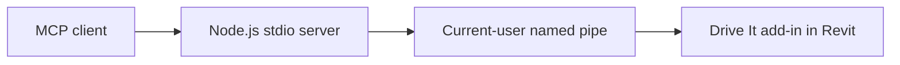

# Drive It

**Connect Model Context Protocol clients to Autodesk Revit on the same Windows workstation.**

[](https://github.com/jedbjorn/drive-it/actions/workflows/build.yml)
[](https://github.com/jedbjorn/drive-it/releases/latest)
[](https://github.com/jedbjorn/drive-it/blob/main/LICENSE)

[](#requirements)
[](#build-and-install)
[](#build-and-install)
[](#requirements)
[](https://md-converter.designs-os.com/?url=https://github.com/jedbjorn/drive-it/blob/main/README.md)

**Topics:** `revit` · `revit-addin` · `bim` · `mcp` · `model-context-protocol` · `dotnet` · `nodejs` · `autodesk`

**[Project website →](https://jedbjorn.github.io/drive-it/)**

## Overview

Drive It connects a Model Context Protocol (MCP) client to Autodesk Revit 2026 through a small Node.js server and a native Revit add-in. The Unguided alpha exposes three stdio MCP tools:

- `get_revit_session` returns the selected process ID, version, build, and current-user named-pipe identity.
- `execute_script` runs inline Python, or an exact saved revision when the script library integration is installed, in an isolated fixed Python worker.
- `get_api_reference` returns local, versioned references for the callable Drive It file, check, and Revit operations. `get_guidance` is not registered.

Generated Python receives `args`, `files`, `revit`, and `checks`. It does not receive raw Revit objects. Typed model operations use the Drive It add-in's current-user named pipe and execute in Revit's API context. The worker uses Python isolated mode, blocks package installation, process execution, native loading, and thread creation, and records observed effects and checks in a durable run receipt.

Drive It is in early development. The Windows alpha installer, source build, and release bundle below are the supported setup paths for this stage.

## How it works

The MCP client launches Drive It's Node.js server over stdio. The server connects to a named pipe created by the Drive It add-in inside the selected Revit process. Each Revit instance has its own pipe, restricted to the current Windows user.



## Workspace and outside-root decisions

Select the persistent workspace through the operator surface. During development, the equivalent direct commands are:

```powershell
node server/operator.js workspace set C:\DriveIt
node server/operator.js workspace get
```

Reads, creates, overwrites, renames, moves, and deletes inside the canonical root do not produce a Drive It prompt. Links and junctions are resolved at the point of use. An outside-root request returns a `pending` receipt and changes nothing in the requested batch. List the request and make a one-time decision:

```powershell
node server/operator.js decisions list
node server/operator.js decisions approve <decision-id>
node server/operator.js decisions deny <decision-id>
```

After approval, retry the same execution with the same idempotency key. The grant is consumed by that execution and is not reused. Denial returns a `denied` receipt. Changing the workspace affects future operations; existing receipts retain their originating root.

Run history remains local to the Windows user and is available after a root change:

```powershell
node server/operator.js history list
node server/operator.js history get <run-id>
```

Completed idempotent requests return their original receipt without repeating effects. Receipts distinguish pending, denied, failed, timed-out, partially applied, and succeeded runs.

## Requirements

The Windows alpha installer requires Windows and Autodesk Revit 2026. It provisions private Node.js and Python runtimes and reuses a suitable existing .NET runtime or provisions .NET 8 in Drive It's private runtime directory. No administrator account, development checkout, global Node.js/npm, or global Python is required.

For a source build, install:

- Windows
- Autodesk Revit 2026
- .NET 8 SDK
- Node.js 22 or newer
- Python 3 for source builds

Revit is required to use the add-in, but not to run the Node.js tests or compile the project. Revit API references resolve from NuGet.

## Build and install

### Windows alpha

Download and extract `drive-it-windows-alpha.zip`, then run `Install-DriveIt.ps1` in PowerShell.

```powershell
.\Install-DriveIt.ps1 -WorkspaceRoot "C:\DriveIt"
```

The installer places the application, private Node.js/Python runtimes, and local data in `%LOCALAPPDATA%\DriveIt`, and writes a ready-to-use stdio configuration to `%LOCALAPPDATA%\DriveIt\mcp.json`. The MCP environment points `DRIVE_IT_DATA_DIR` at that data directory and `DRIVE_IT_PYTHON` at the bundled Python executable. The installer verifies the runtimes and starts the installed MCP server before registering the current-user Revit 2026 add-in. Existing toolchains are not replaced.

To merge the same entry into a selected MCP client configuration while preserving its other servers, pass `-McpConfigPath <path>`. Re-running the installer preserves the selected root and existing client settings. Use `-NoLaunch` for unattended installation.

Drive It opens from the Start Menu for first-run root selection. The same surface changes the root, shows each pending outside-root operation and resolved path, records a one-time approval or denial, and displays retained run receipts. Approval does not change the root or authorize later requests.

The operator surface uses the installed private Node runtime to call `server/operator.js` directly: `workspace get|set`, `decisions list|approve|deny`, and `history list`. These commands are not MCP tools. The shared local state contract is:

- `workspace.json`: the selected root used for future operations.
- `decisions/<id>.json`: pending, approved, denied, or consumed requests with canonical `operation` and `paths` details. Approval is consumed once and never reused for another request.
- `runs/<run-id>.json`: retained receipts displayed independently of the current root.

### Source build

From a source checkout, run these commands in PowerShell with Revit closed:

```powershell
npm ci
dotnet build src/DriveIt.Revit -c Release

$build = "src/DriveIt.Revit/bin/Release/net8.0-windows"
$addins = Join-Path $env:APPDATA "Autodesk/Revit/Addins/2026"
New-Item -ItemType Directory -Force "$addins/DriveIt" | Out-Null
Copy-Item "$build/DriveIt.Revit.dll" "$addins/DriveIt/"
Copy-Item "$build/DriveIt.addin" "$addins/"
```

Tagged releases provide the same compiled add-in and MCP server as `DriveIt-<version>.zip`, together with `SHA256SUMS.txt`. Extract the bundle, run `npm ci` in its directory, then copy `DriveIt.addin` and the `DriveIt` folder into `%APPDATA%\Autodesk\Revit\Addins\2026` as above.

Start Revit and allow the add-in to load. Configure your MCP client to launch the server over stdio, replacing the example path with your checkout or extracted release bundle:

```json
{
  "mcpServers": {
    "drive-it": {
      "command": "node",
      "args": ["C:\\Repos\\drive-it\\server\\index.js"]
    }
  }
}
```

The installed alpha supplies its own Node and fixed Python runtime. `DRIVE_IT_PYTHON` selects the Python executable during development or installed setup. Runtime state defaults to `%LOCALAPPDATA%\DriveIt`; `DRIVE_IT_DATA_DIR` overrides it for isolated development tests.

## Use

Run `Get-Process Revit | Select-Object Id, MainWindowTitle` in PowerShell and pass the desired `processId` to `get_revit_session` or `execute_script`.

A successful session response contains the selected Revit process and its version information:

```json
{
  "processId": 12345,
  "version": "2026",
  "build": "26.4.10.51"
}
```

If the connection fails, check that the process ID belongs to Revit and that the Drive It add-in loaded successfully.

## Revit broker

The current-user named pipe `\\.\pipe\drive-it-<pid>` retains its session greeting. After reading the greeting, an execution client sends one newline-delimited JSON request and reads one JSON response on that connection:

```json
{
  "id": "<run uuid>",
  "type": "model.execute",
  "document": { "path": "<canonical path or null>", "uniqueId": "<broker-issued identity or null>" },
  "workspaceRoot": "<canonical root>",
  "operations": [{ "type": "read_document", "arguments": {} }]
}
```

Document operations are `open_document`, `create_document`, `read_document`, `save_document`, `save_as_document`, `close_document`, and `delete_document`. Typed model changes are `create_level`, `create_wall`, `create_family_type`, and `delete_element`. Consecutive model changes run in one Revit transaction through `ExternalEvent`. The response's `document.uniqueId` remains bound to the same Revit document across save-as.

Responses have `succeeded`, `failed`, `partially_applied`, or `policy_required` status and list observed `changes`, `affectedFiles`, `affectedElements`, and `checks`. Before any mutation, the broker canonicalizes the complete batch, including links and junctions. An uncovered outside-root read or effect returns `policy_required` with `policyRequests`. Node can retry with an operator decision:

```json
{
  "outsideRootApproval": {
    "decisionId": "<node-generated decision>",
    "grants": [{ "operation": "save_as_document", "paths": ["<resolved path>"] }]
  }
}
```

Only the Node broker client may attach this payload; generated Python cannot approve its own request. Grants cover only the matching operation and canonical paths in that execution and are not persisted.

## Development

Build the self-contained installer package on a development machine with `installer/Build-DriveItPackage.ps1`. The builder runs npm and dotnet only while packaging, downloads the fixed official Node.js/Python runtimes, bundles production dependencies, and creates `artifacts/DriveIt-alpha.zip`.

- `server/app.js` registers the MCP tools and their schemas.
- `server/runtime.js` owns execution, broker policy retries, receipts, and idempotent replay.
- `server/worker.py` mediates Python file and typed Revit operations and blocks package/process installation paths.
- `server/workspace.js`, `server/decisions.js`, and `server/history.js` persist policy and run evidence outside the selected workspace.
- `src/DriveIt.Revit/App.cs` serves the session greeting and typed requests. `Broker/RevitBroker.cs` raises an external event, and `Broker/DocumentDispatcher.cs` executes document and model operations in Revit's API context.
- `npm test` exercises real stdio discovery, isolated Python execution, policy and failure paths, replay, operator commands, and temporary-file cleanup. Windows runs also exercise the named-pipe session, newline-JSON broker contract, operator state, approvals, and run history.
- `dotnet build src/DriveIt.Revit -c Release` compiles the Revit 2026 add-in.
- CI builds the Windows alpha installer and performs an installed-server smoke test.
- `test/revit-broker.integration.ps1` exercises the live broker against a running Revit process. Copy a project template to `C:\DriveIt\broker-fixtures\broker-project.rte` and a family template to `broker-family.rft`, then run `powershell -ExecutionPolicy Bypass -File test/revit-broker.integration.ps1 -ProcessId <pid>`. It writes JSONL receipts to that workspace and uses only disposable model files.

GitHub Actions runs the tests and build on `windows-latest` for pull requests and pushes to `main`. It uses only GitHub-hosted runners; no local runner or Revit installation is required. Live Revit verification is a separate manual check.

Live RVT/RFA behavior still requires the installed-alpha Revit fixtures and acceptance environment; local mocks and pipe tests do not establish live model proof.

To release, push a `v<major>.<minor>.<patch>` tag for a commit on `main`, optionally with a prerelease suffix such as `-rc.1`. The release workflow runs the same build, packages the add-in and server, verifies a SHA-256 checksum, and creates a GitHub Release.

## Contributing

Issues and focused pull requests are welcome. Include the Revit and Windows versions for add-in reports, and do not attach private models, credentials, or other sensitive data. Before submitting a change, run `npm test` and `dotnet build src/DriveIt.Revit -c Release` where your environment supports them.

## More projects

Other open-source projects by the same author, published as [Designs/OS](https://designs-os.com):

- **[RST-C](https://jedbjorn.github.io/rst-c/)** — curated Revit ribbon profiles in one native add-in. ([source](https://github.com/jedbjorn/rst-c))
- **[Gantt-It](https://jedbjorn.github.io/gantt-it/)** — Gantt charts inside Revit, ready to place on sheets. ([source](https://github.com/jedbjorn/gantt-it))
- **[Splash-It](https://jedbjorn.github.io/splash-it/)** — colors Revit view tabs by file. ([source](https://github.com/jedbjorn/splash-it))
- **[Pick-It](https://jedbjorn.github.io/pick-it/)** — picks a color and shows its RGB values on the Revit ribbon. ([source](https://github.com/jedbjorn/pick-it))
- **[FAI Browser](https://jedbjorn.github.io/fai-browser/)** — a safer browser for coding agents. ([source](https://github.com/jedbjorn/fai-browser))
- **[Subfloor](https://subfloor.designs-os.com)** — persistent coding-agent teams with durable identity, memory, specs, and handoffs. ([source](https://github.com/jedbjorn/subfloor))

## License

[MIT](LICENSE) · Copyright © 2026 Designs/OS
