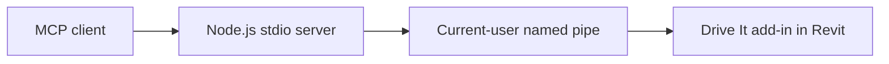

# Drive It

**Connect Model Context Protocol clients to Autodesk Revit on the same Windows workstation.**

[](https://github.com/jedbjorn/drive-it/actions/workflows/build.yml)
[](https://github.com/jedbjorn/drive-it/releases/latest)
[](https://github.com/jedbjorn/drive-it/blob/main/LICENSE)

[](#requirements)
[](#build-and-install)
[](#build-and-install)
[](#requirements)
[](https://md-converter.designs-os.com/?url=https://github.com/jedbjorn/drive-it/blob/main/README.md)

**Topics:** `revit` · `revit-addin` · `bim` · `mcp` · `model-context-protocol` · `dotnet` · `nodejs` · `autodesk`

**[Project website →](https://jedbjorn.github.io/drive-it/)**

## Overview

Drive It connects a Model Context Protocol (MCP) client to Autodesk Revit through a small Node.js server and a native Revit add-in. Its first tool, `get_revit_session`, returns the process ID, version, and build of a running Revit instance. It works with the Revit home screen or an open model.

Drive It is in early development. The current `main` branch provides Revit session discovery; it does not yet execute modeling operations or ship a dedicated installer. The source build and release bundle below are the supported setup paths for this stage.

## How it works

The MCP client launches Drive It's Node.js server over stdio. The server connects to a named pipe created by the Drive It add-in inside the selected Revit process. Each Revit instance has its own pipe, restricted to the current Windows user.



## Requirements

- Windows
- Autodesk Revit 2026
- .NET 8 SDK
- Node.js 22 or newer

Revit is required to use the add-in, but not to run the Node.js tests or compile the project. Revit API references resolve from NuGet.

## Build and install

From a source checkout, run these commands in PowerShell with Revit closed:

```powershell
npm ci
dotnet build src/DriveIt.Revit -c Release

$build = "src/DriveIt.Revit/bin/Release/net8.0-windows"
$addins = Join-Path $env:APPDATA "Autodesk/Revit/Addins/2026"
New-Item -ItemType Directory -Force "$addins/DriveIt" | Out-Null
Copy-Item "$build/DriveIt.Revit.dll" "$addins/DriveIt/"
Copy-Item "$build/DriveIt.addin" "$addins/"
```

Tagged releases provide the same compiled add-in and MCP server as `DriveIt-<version>.zip`, together with `SHA256SUMS.txt`. Extract the bundle, run `npm ci` in its directory, then copy `DriveIt.addin` and the `DriveIt` folder into `%APPDATA%\Autodesk\Revit\Addins\2026` as above.

Start Revit and allow the add-in to load. Configure your MCP client to launch the server over stdio, replacing the example path with your checkout or extracted release bundle:

```json
{
  "mcpServers": {
    "drive-it": {
      "command": "node",
      "args": ["C:\\Repos\\drive-it\\server\\index.js"]
    }
  }
}
```

## Use

Run `Get-Process Revit | Select-Object Id, MainWindowTitle` in PowerShell. Ask your MCP client to call `get_revit_session` with the desired `processId`.

A successful response contains the selected Revit process and its version information:

```json
{
  "processId": 12345,
  "version": "2026",
  "build": "26.4.10.51"
}
```

If the connection fails, check that the process ID belongs to Revit and that the Drive It add-in loaded successfully.

## Development

- `server/index.js` registers the MCP tool and reads session metadata from the named pipe.
- `src/DriveIt.Revit/App.cs` captures version information during Revit startup and serves that snapshot over the pipe.
- `npm test` starts the MCP server, discovers the tool, and checks the disconnected response. On Windows it also calls the tool against a test pipe.
- `dotnet build src/DriveIt.Revit -c Release` compiles the Revit 2026 add-in.

GitHub Actions runs the tests and build on `windows-latest` for pull requests and pushes to `main`. It uses only GitHub-hosted runners; no local runner or Revit installation is required. Live Revit verification is a separate manual check.

To release, push a `v<major>.<minor>.<patch>` tag for a commit on `main`, optionally with a prerelease suffix such as `-rc.1`. The release workflow runs the same build, packages the add-in and server, verifies a SHA-256 checksum, and creates a GitHub Release.

## Contributing

Issues and focused pull requests are welcome. Include the Revit and Windows versions for add-in reports, and do not attach private models, credentials, or other sensitive data. Before submitting a change, run `npm test` and `dotnet build src/DriveIt.Revit -c Release` where your environment supports them.

## More projects

Other open-source projects by the same author, published as [Designs/OS](https://designs-os.com):

- **[RST-C](https://jedbjorn.github.io/rst-c/)** — curated Revit ribbon profiles in one native add-in. ([source](https://github.com/jedbjorn/rst-c))
- **[Gantt-It](https://jedbjorn.github.io/gantt-it/)** — Gantt charts inside Revit, ready to place on sheets. ([source](https://github.com/jedbjorn/gantt-it))
- **[Splash-It](https://jedbjorn.github.io/splash-it/)** — colors Revit view tabs by file. ([source](https://github.com/jedbjorn/splash-it))
- **[Pick-It](https://jedbjorn.github.io/pick-it/)** — picks a color and shows its RGB values on the Revit ribbon. ([source](https://github.com/jedbjorn/pick-it))
- **[FAI Browser](https://jedbjorn.github.io/fai-browser/)** — a safer browser for coding agents. ([source](https://github.com/jedbjorn/fai-browser))
- **[Subfloor](https://subfloor.designs-os.com)** — persistent coding-agent teams with durable identity, memory, specs, and handoffs. ([source](https://github.com/jedbjorn/subfloor))

## License

[MIT](LICENSE) · Copyright © 2026 Designs/OS
