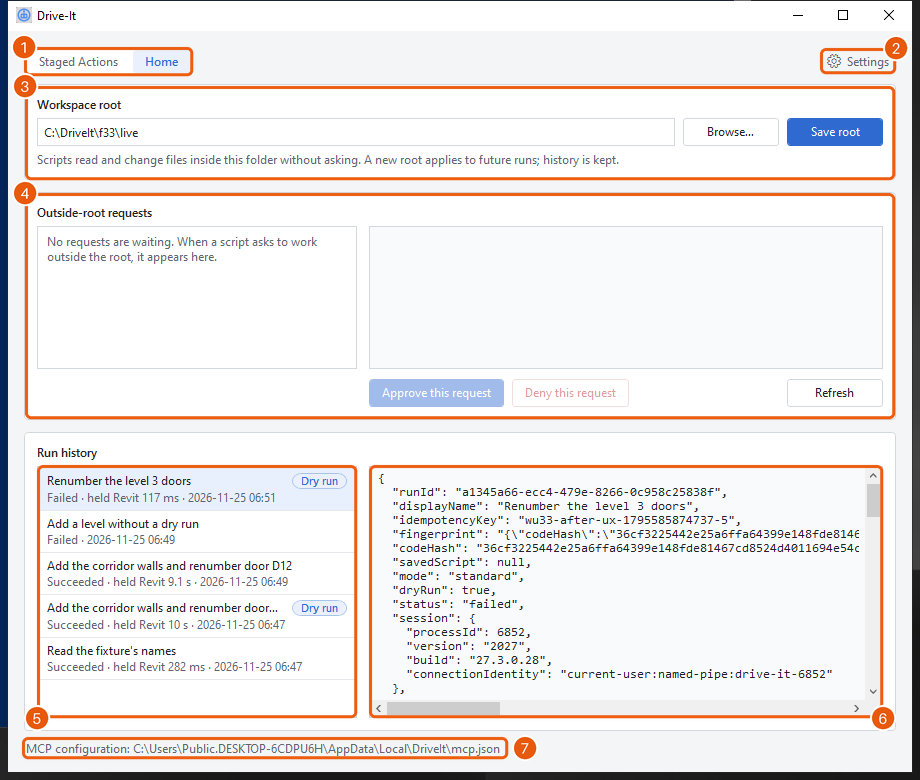

# Install

Requirements, client registration, unattended install and uninstall, the script installer, the Drive-It window and source builds.

## Requirements

The Windows alpha installer requires Windows and Autodesk Revit 2026, Revit 2027, or both. It provisions private Node.js and Python runtimes and reuses a suitable existing .NET runtime (8 or later: Revit 2026 installs .NET 8 and Revit 2027 installs .NET 10, and the Drive-It window runs on either) or provisions .NET 8 in Drive-It's private runtime directory. No administrator account, development checkout, global Node.js/npm, or global Python is required.

The add-in is built twice from one source: for Revit 2026 on .NET 8 against the 2026 API, and for Revit 2027 on .NET 10 against the 2027 API. Every install registers both, whichever Revit is present:

| Revit | Add-in manifest | Add-in build |
|---|---|---|
| 2026 | `%APPDATA%\Autodesk\Revit\Addins\2026\DriveIt.addin` | `%LOCALAPPDATA%\DriveIt\app\addin\2026` (.NET 8) |
| 2027 | `%APPDATA%\Autodesk\Revit\Addins\2027\DriveIt.addin` | `%LOCALAPPDATA%\DriveIt\app\addin\2027` (.NET 10) |

For a source build, install:

- Windows
- Autodesk Revit 2026 or 2027
- .NET 8 and .NET 10 SDKs
- Node.js 22 or newer
- Python 3 for source builds

Revit is required to use the add-in, but not to run the Node.js tests or compile the project. Revit API references resolve from NuGet.

## Windows (MSI)

The MSI installation steps are in the [README](../README.md#install).

Drive-It is a companion of [RST](https://github.com/jedbjorn/rst-c): RST's tray can install Drive-It and keep it up to date from full releases. Drive-It does not need RST, and works the same however it was installed. It appears in Settings > Apps as **Drive-It**.

The MSI registers Drive-It with every supported MCP client it finds for your Windows user, and leaves everything else in their configuration unchanged:

| Client | Detected by | Configuration written |
|---|---|---|
| Claude Desktop | `%APPDATA%\Claude` exists | `mcpServers.drive-it` in `%APPDATA%\Claude\claude_desktop_config.json` |
| Claude Desktop (Microsoft Store) | `%LOCALAPPDATA%\Claude-Data\claude_<id>` exists | `mcpServers.drive-it` in `claude_desktop_config.json` in that folder |
| Claude Code | `%USERPROFILE%\.claude.json` or `%USERPROFILE%\.local\bin\claude.exe` exists | a user-scope `drive-it` server, added with `claude mcp add-json -s user` when the CLI is installed, otherwise written to `mcpServers.drive-it` in `%USERPROFILE%\.claude.json` |
| Codex CLI and the ChatGPT desktop app | `%USERPROFILE%\.codex` exists, or the ChatGPT/Codex Microsoft Store app is installed | a marked `[mcp_servers.drive-it]` block in `%USERPROFILE%\.codex\config.toml` (created if missing), with a 30-second startup timeout and a 630-second tool timeout |

Before changing a client file, the installer saves a copy next to it as `<file>.drive-it.bak`. If a client configuration cannot be read, `config.toml` is not valid TOML, or Codex already defines its own `drive-it` server, that client is skipped and its file is left untouched. The updated `config.toml` is also parsed before it is saved, because a malformed file stops the ChatGPT and Codex apps from starting. If you install Claude or ChatGPT after Drive-It, open the Drive-It window, click **Settings**, press **Detect agents**, then restart that app. It adds the same entry the installer adds, with the same backup and safety rules, and lists each client as Added, Already set up, Not installed, or Could not add with the reason. You can also copy the entry from `%LOCALAPPDATA%\DriveIt\mcp.json` into any other stdio MCP client.

To remove Drive-It, uninstall it from Settings > Apps. This removes the application, the Revit 2026 and 2027 add-in registrations, the Start Menu shortcut, and the `drive-it` entries it added to Claude and Codex. Your workspace selection and run receipts in `%LOCALAPPDATA%\DriveIt` are kept.

For an unattended install, upgrade, or removal, use the same command lines RST's tray uses; each exits `0` on success and never asks for a reboot:

```powershell
msiexec /i DriveIt-<version>.msi /qn /norestart MSIRESTARTMANAGERCONTROL=Disable
msiexec /x DriveIt-<version>.msi /qn /norestart MSIRESTARTMANAGERCONTROL=Disable
```

A newer MSI upgrades an installed Drive-It in place; an older one is refused while a newer version is installed. Before replacing or removing files, the MSI stops Drive-It's own processes running from `%LOCALAPPDATA%\DriveIt\app` (the MCP server's Node.js and Python, and an open Drive-It window), so an MCP client loses its Drive-It connection until it is restarted. Close Revit before upgrading or uninstalling: the MSI never stops Revit, and a running Revit keeps the add-in's files open, which would need a reboot.

## Windows alpha (script installer)

The script installer is still available: extract `drive-it-windows-alpha.zip` from a CI build and run `Install-DriveIt.ps1` in PowerShell.

```powershell
.\Install-DriveIt.ps1 -WorkspaceRoot "C:\DriveIt"
```

Both installers place the application, private Node.js/Python runtimes, and local data in `%LOCALAPPDATA%\DriveIt`, write a ready-to-use stdio configuration to `%LOCALAPPDATA%\DriveIt\mcp.json`, and register the detected clients above. The MCP environment points `DRIVE_IT_DATA_DIR` at that data directory and `DRIVE_IT_PYTHON` at the bundled Python executable. The installer verifies the runtimes and starts the installed MCP server before registering the current-user Revit 2026 and 2027 add-ins. `Uninstall-DriveIt.ps1` removes every year's add-in registration that names its install. Existing toolchains are not replaced.

With the script installer, pass `-McpConfigPath <path>` to merge the same entry into another MCP client configuration while preserving its other servers. Re-running the installer preserves the selected root and existing client settings. Use `-NoLaunch` for unattended installation.

## The Drive-It window

The Drive-It window opens from the Start Menu (`Drive-It`) and from the **Drive-It** panel on Revit's **Add-Ins** tab; inside Revit it follows Revit's light or dark theme, and from the Start Menu the Windows app theme. Use it for first-run root selection. The same window changes the root, shows each pending outside-root operation and resolved path, records a one-time approval or denial, and displays retained run receipts. Approval does not change the root or authorize later requests. Its **Settings** button, top right, opens a drawer over the window with the Script time limit (10 to 600 seconds, applied to runs that start after it is saved), the [Require dry run](dry-run.md#require-dry-run) switch, and **Detect agents**, which adds Drive-It to Claude and ChatGPT installed after Drive-It; the drawer reads the stored settings each time it opens. While Require dry run is on, a **Staged Actions | Home** switcher at the top left shows the last dry run in the workspace.



1. **Staged Actions | Home**: shown while [Require dry run](dry-run.md#require-dry-run) is on; Staged Actions shows the last dry run in the workspace.
2. **Settings**: opens the drawer with the Script time limit, Require dry run and **Detect agents**.
3. **Workspace root**: scripts read and change files inside it without asking. A new root applies to future runs.
4. **Outside-root requests**: each pending request and its resolved path, to approve or deny once.
5. **Run history**: runs by display name; a dry run carries a **Dry run** label.
6. The selected run's receipt.
7. **MCP configuration**: the path of `mcp.json`, the stdio entry you can copy into another MCP client.

The window (`app\operator\DriveIt.Operator.exe`, and `DriveIt.UI.dll` in each year's add-in folder) uses the installed private Node runtime to call `server/operator.js` directly: `workspace get|set`, `decisions list|approve|deny`, `history list`, `settings get|set-time-limit|set-require-dry-run` (the Settings drawer), `staged get` (Staged Actions: the last dry run that completed in the workspace), and `clients detect [mcp.json]` (Detect agents: the installer's client registration for the current user). Runs and pending requests are listed by their display name when they carry one, with the run ID in the details. These commands are not MCP tools. The shared local state contract is:

- `workspace.json`: the selected root used for future operations.
- `decisions/<id>.json`: pending, approved, denied, or consumed requests with canonical `operation` and `paths` details. Approval is consumed once and never reused for another request.
- `runs/<run-id>.json`: retained receipts, each with the run's `displayName`, displayed independently of the current root.

## Source build

From a source checkout, run these commands in PowerShell with Revit closed:

```powershell
npm ci
dotnet build src/DriveIt.Revit -c Release

# One build per Revit year: 2026 is net8.0-windows, 2027 is net10.0-windows.
foreach ($target in @(@{ Year = "2026"; Framework = "net8.0-windows" }, @{ Year = "2027"; Framework = "net10.0-windows" })) {
  $build = "src/DriveIt.Revit/bin/Release/$($target.Framework)"
  $addins = Join-Path $env:APPDATA "Autodesk/Revit/Addins/$($target.Year)"
  New-Item -ItemType Directory -Force "$addins/DriveIt" | Out-Null
  Copy-Item "$build/DriveIt.Revit.dll", "$build/DriveIt.UI.dll", "$build/DriveIt.Core.dll" "$addins/DriveIt/"
  Copy-Item "$build/DriveIt.addin" "$addins/"
}
```

Tagged releases also provide the compiled add-ins and MCP server as `DriveIt-<version>.zip`, with checksums for every asset in `SHA256SUMS.txt`. Extract the bundle, run `npm ci --omit=dev` in its directory, then copy the contents of its `2026` or `2027` folder (`DriveIt.addin` and the `DriveIt` folder) into `%APPDATA%\Autodesk\Revit\Addins\<year>` for that year.

Start Revit and allow the add-in to load. Configure your MCP client to launch the server over stdio, replacing the example path with your checkout or extracted release bundle:

```json
{
  "mcpServers": {
    "drive-it": {
      "command": "node",
      "args": ["C:\\Repos\\drive-it\\server\\index.js"]
    }
  }
}
```

The installed alpha supplies its own Node and fixed Python runtime. `DRIVE_IT_PYTHON` selects the Python executable during development or installed setup. Runtime state defaults to `%LOCALAPPDATA%\DriveIt`; `DRIVE_IT_DATA_DIR` overrides it for isolated development tests.
